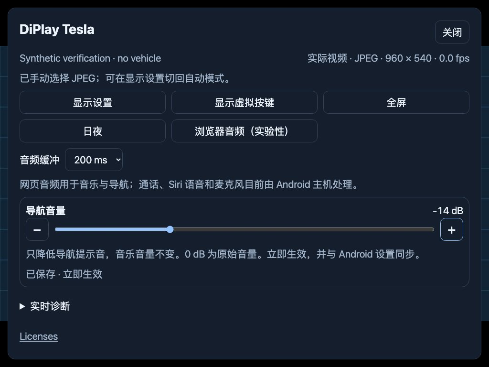

# DiPlay Tesla

让 Tesla 浏览器使用 CarPlay 的 Android 接收端。Android 主机连接 iPhone，Tesla 在同一网络打开网页，显示 CarPlay 画面并接收触控、音乐和导航提示音。

[下载 0.1.10 完整连接版](https://github.com/WangZhuo2015/DiPlay-tesla/releases/tag/tesla-v0.1.10) · **[中文使用指南](docs/TESLA-QUICKSTART.zh-CN.md)** · [English guide](docs/TESLA-QUICKSTART.md) · [问题反馈](https://github.com/WangZhuo2015/DiPlay-tesla/issues)

> 当前公开下载仍为 **0.1.10**。本分支在准备 **0.1.11**：导航音量、视频状态和性能调整均属于尚未发布的候选源码，不能把下面的介绍当作旧 APK 已有的功能或新版本的实车验证。

## 需要什么

- 允许安装 APK 的 Android 主机，Android 7.1／API 25 或更高版本。
- 支持 CarPlay 的 iPhone，以及带浏览器的 Tesla。
- Tesla 与 Android 主机之间可达的网络。可以使用主机热点，也可以按使用指南配置现有局域网。
- 若固件限制浏览器访问内网地址，还需要自行配置可达的网关、DNS 和可信 HTTPS 入口。

**历史实测组合：** 0.1.10 在 2026 Model Y Juniper、ZTE V50、iPhone 16 Pro Max／17 Pro Max（iOS 27.0.1）上确认音频和触摸正常。这不覆盖其他车型、固件，也不等于新候选版本已经完成实车验证。[查看实测范围](docs/testing/tesla/README.md#model-y-juniper-vehicle-report--2026-10-12)

## 安装与连接

1. 将完整连接 APK 安装到 **Android 主机**，打开应用并授予连接所需权限。
2. 按[中文使用指南](docs/TESLA-QUICKSTART.zh-CN.md)配置 iPhone 与主机的连接。无线连接时保存实际使用的热点信息，保持 iPhone 蓝牙和 Wi-Fi 开启，选择手机并连接。
3. 让 Tesla 连接同一网络。在 Android 的 **设置 → 连接 → Tesla 浏览器（实验性）**查看入口地址及六位配对码。
4. 在 Tesla 浏览器打开入口，输入配对码。配对码有效五分钟；过期后重新打开 Android 连接页获取。配对成功后，该浏览器会记住连接。
5. 播放音乐。若浏览器要求手势，点一下页面启动声音；此前手动关闭过音频时，在菜单中重新开启。

完整连接版包含明确配置的实验性配件身份，用于本地 iPhone 认证；它不是 Apple 为本项目新签发的 MFi 身份。[来源和范围说明](docs/THIRD_PARTY_NOTICES.md#experimental-authentication-data)保留在源码中。

### 入口与 HTTPS

APK 自身提供 HTTP 服务；HTTPS 需要单独部署。可参考[Android 本机网关](proxy/android-root/README.md)（需要 root）或[独立 proxy](proxy/README.md)，使用自己的域名、DNS 和证书。公开文件不包含用户的 HTTPS 私钥、热点密码或路由配置。

部分 Tesla 固件会限制内网 IP 访问。手机或电脑能打开入口，不能证明车机也能打开；仅换域名或加 HTTPS 也不能保证解决。[内网访问限制与配置说明](docs/TESLA-QUICKSTART.zh-CN.md#tesla-内网-ip-访问限制)

## 常用设置

顶部中央的小把手打开菜单，闲置约两秒后收起。虚拟按键默认隐藏，可在菜单中展开；画面和触控坐标不会随按键区域缩放。

| 设置 | 用途与生效方式 |
| --- | --- |
| 显示预设 | 适配窗口、720p、1080p、2K，最高 2560×1440；适配缩放支持 1/2、3/4、1×。先选车机当前窗口，再选预设。 |
| 右侧／全屏 | 两份尺寸独立保存。尺寸和请求帧率在下次 CarPlay 连接生效，需要立即使用时明确选择“应用并重新连接”。 |
| 视频传输 | 默认优先 H.264 WebRTC；失败时回退 JPEG。JPEG 画质只影响回退画面，调高画质或分辨率会增加负载。 |
| 浏览器音频 | 用于音乐和导航提示，默认开启并记住手动关闭状态。音频缓冲可选 80／200／400 ms。 |
| 导航音量（0.1.11 候选） | 网页提供滑块和 ± 按钮，范围 −20～0 dB；0 dB 保留原音量，只降低导航提示，音乐音量不变。与 Android 设置共用保存值，立即生效。 |
| 实际视频状态（0.1.11 候选） | 菜单直接显示实际路线、收到的尺寸、实测帧率及回退原因。统计不可用显示“未知”；静止画面可以实测为 0 fps。 |

[显示预设与屏幕说明](docs/TESLA-DISPLAY-PRESETS.md) · [连接和媒体边界](docs/TESLA.zh-CN.md)

0.1.11 候选还整合了有界 JPEG 工作、缓冲复用、按浏览器需求启停转换、RTC 排队路径和可选 Canvas 显示的性能调整。它们旨在减少不必要的工作；已有主机基准不代表车机帧率、温度或延迟已经改善。[性能说明与实测计划](docs/browser-performance.md)

## 故障排查

| 现象 | 先检查什么 |
| --- | --- |
| 车机打不开入口 | 车机与主机的网络是否可达，以及当前 Tesla 固件的内网访问限制。按上面的入口指南检查网关、DNS 和证书。 |
| 一直显示 JPEG／画面较慢 | 视频传输是否选了“自动”；记录实际分辨率、fps 和回退原因。WebRTC 还需要浏览器能直达 Android 的媒体通路，HTTP／HTTPS 网关并不转发该 UDP 通路。 |
| 没声音 | 点一下页面解锁自动播放，检查浏览器音频开关及主机音频。缓冲增加会增加延迟。 |
| 导航太响 | 0.1.11 候选可调“导航音量”；车上的总音量按钮仍可能同时改变网页音乐与导航音量。 |
| 保存尺寸后没变化 | 查看是否提示等待下次连接；准备好后选择“应用并重新连接”。 |
| 配对失效 | 重新打开 Android 连接页获取新码。连接中断或保存未确认时，先等待状态回读再操作。 |

反馈时注明 APK 版本、Android 主机型号与系统、Tesla 型号及固件、iPhone／iOS、网络方式、窗口和分辨率、问题发生时间，并提供菜单中的实际路线、帧率和回退原因。请先检查诊断内容，移除域名、热点密码、配对凭据和其他私人信息，再[提交问题](https://github.com/WangZhuo2015/DiPlay-tesla/issues)。

## 当前限制

- 通话、Siri 语音和麦克风仍由 Android 主机处理；网页不采集或回传麦克风。
- 不保证所有 Tesla 固件、Android 主机和 iOS 组合均可用；持续高分辨率播放、发热和音视频延迟需要分别验证。
- 新候选版本尚未完成 V50／Tesla 实车续测。操作设置与比较版本时请先停车。
- 普通源码／CI 调试包默认不含独立连接所需的认证资源。覆盖更新需要相同包名和原发布签名；独立 debug 包不能覆盖正式版。

## 开发与版本

| 目录 | 职责 |
| --- | --- |
| `tesla` | Tesla 版 Android APK 与应用装配 |
| `browser` | 网页、HTTP／WebSocket、WebRTC 和 JPEG 回退 |
| `common`／`shared` | Android 界面、CarPlay 核心与连接能力 |
| `proxy` | 可单独部署的网关，不承接核心 CarPlay 连接 |

Tesla 源码调试构建选择 `:tesla:assembleDebug`。独立连接构建需显式提供有权使用的外部认证资源；Android APK 发布签名另行配置，不进入 Git。

[构建说明](docs/BUILD.md) · [Tesla 技术说明](docs/TESLA.md) · [0.1.11 候选说明](docs/RELEASE-NOTES-TESLA-0.1.11.md) · [验证记录](docs/testing/tesla/README.md)

## 来源与许可

本项目沿用 [DiPlay](https://github.com/shihabal3amri/DiPlay)／[xcertplay](https://github.com/shilapi/xcertplay) 的接收端代码；界面与网站的部分内容适配自 [DiAuto](https://github.com/shihabal3amri/DiAuto)。Tesla 传输与策略还参考了 tepla、DiPlay-CN、WheelPlay 等项目，具体范围与作者署名见[第三方声明](docs/THIRD_PARTY_NOTICES.md)。

保留根目录 [LICENSE](LICENSE)（GPL-3.0）、相关 AGPL-3.0 组件许可及其他依赖声明。CarPlay 和相关图标属于 Apple；Tesla 商标属于其权利人。本项目不表示获得 Apple 或 Tesla 的认证、认可或合作关系。
