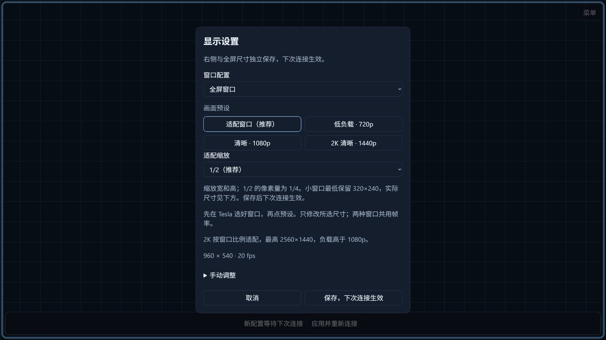

# DiPlay Tesla

This fork adds a Tesla browser output to the existing Android CarPlay receiver. A separate
`tesla` APK composes the core with the `browser` library; the optional Node.js `proxy/`
process is deployed independently. Tesla and the Android host share a local network.

Version 0.1.7 offers Fit window, Low load (720p), Clear (1080p) and 2K clear (1440p)
presets, with manual parameters collapsed by default. Presets use the
actual viewport aspect ratio, retain the other window's dimensions and apply on the
next connection. [Screen sources, preset values and public screenshots](docs/TESLA-DISPLAY-PRESETS.md)
show synthetic layout content without real vehicle or account data.

Fit window adds 1/2 (default), 3/4 and 1× scaling, remembered separately for right/full
profiles in this browser after saving. Half width and height use a quarter of the pixels.
An independent [rooted Android HTTPS gateway](proxy/android-root/README.md) can run on
the hotspot host. Real domains, routing addresses and certificate settings stay in local
ignored configuration; the repository contains only a template and generator.

Version 0.1.2 adds a full-viewport browser surface, hidden-by-default virtual keys, live diagnostics and static-screen protection. It retains H.264 WebRTC with automatic JPEG fallback and optional browser PCM
audio with 80/200/400 ms buffering. Right/full resolutions remain independent. Vehicle
performance is not yet validated.

Right-window and full-window profiles have independent configurable resolutions. Touch,
Siri and media shortcuts are supported. Saved display changes wait for the next connection
or an explicit Apply and reconnect. Selected DiPlay-CN locale, connection-hint and resume
behaviors are adapted for this output.

See [Tesla setup and boundaries](docs/TESLA.md) and [optional proxy](proxy/README.md).
The latest public APK is the [Tesla 0.1.1 signed preview](https://github.com/WangZhuo2015/DiPlay-tesla/releases/tag/tesla-v0.1.1).
The 0.1.2 Release remains a draft; its credential-bearing APK is available locally only.
The independent proxy accepts TLS certificates for HTTPS; the Android browser service uses HTTP.
The 0.1.3 local test build tries ports 8080–8089 when firmware already owns 8080;
the Connection settings show the actual URL. Set the proxy upstream to that actual port.
Local standalone APKs bundle the explicitly provisioned experimental MFi identity.
The 0.1.3 [local V50 test](docs/testing/tesla/README.md#013-v50-local-test--2026-10-11)
authenticated an iPhone wirelessly and displayed real H.264 / WebRTC CarPlay.
Sustained audio and Tesla vehicle performance still require testing.
The 0.1.4 local build adds six-digit pairing with a remembered browser connection,
browser-only video decoding and a horizontal menu at the top. See its
[release notes](docs/RELEASE-NOTES-TESLA-0.1.4.md) for the local testing scope.
Build with `./gradlew :tesla:assembleDebug`; source-only APKs still require externally
provisioned CarPlay authentication assets to connect an iPhone. The original DiPlay
documentation follows.

**CarPlay for compatible BYD Android head units.** Wired and wireless, with the familiar DiAuto interface. Independent app: `com.shihab.diplay`.

> **BYD support scope:** These projects focus on BYD cars. They may work on other brands, but other brands are unsupported and there are no plans to add support or fix brand-specific incompatibilities.

[Download & website](https://shihabal3amri.github.io/DiPlay/) · [Release](https://github.com/shihabal3amri/DiPlay/releases/tag/v0.2.16) · [Report a problem](https://github.com/shihabal3amri/DiPlay/issues/new/choose)

## 0.2.16 — public preview

Install on the **car**, not the iPhone. No jailbreak, dongle, Mac, account or authentication server is required for use. Core CarPlay does not require ADB; optional dashboard, battery, wheel-speed and parked-video features do. Your head unit must permit APK installation. The APK supports Android 7.1+ (API 25); Android 7.1–8.1 support is not yet confirmed on a vehicle. Wireless supports Wi-Fi Direct, the car’s existing hotspot or Existing Wi-Fi / Same LAN. Android 7.1–9 Wi-Fi Direct uses a firmware-dependent legacy path with generated group credentials and unverified requested frequency; see [Android 9 Wi-Fi Direct](docs/ANDROID9_WIFI_DIRECT.md). Android 10+ verifies its negotiated group frequency.

- Wired USB and wireless CarPlay with local authentication.
- BYD HUD navigation with arrows, distance and street names on verified firmware.
- Car hotspot support, improved audio buffering and saved receive diagnostics.
- Automatic address discovery, fixed-channel Wi-Fi fallbacks and successful-configuration memory.
- Icon/text size, resolution and frame rate; applying a display change reconnects CarPlay.
- Local diagnostic export. Reports are sent only if you choose to share them.
- Separate installation alongside DiAuto. Run one projection app at a time.

This is **not an Apple-certified product**. The APK bundles an experimental accessory identity recovered from public Carlinkit firmware, not a newly provisioned MFi identity for DiPlay. A bundled private key is extractable. Acceptance after future iOS updates, reliability across head units and suitability of that identity for general distribution are unresolved. This release invites community testing; it is not a guarantee of universal compatibility.

Earlier releases were tested on the development DiLink5.1 car: live windshield guidance and street names work, Car hotspot now starts CarPlay, and Wi-Fi Direct performance is substantially improved. Audio underrun recovery is improved in 0.2.15; remaining cutouts need current diagnostic reports. The 0.2.16 software Opus microphone fallback was accepted on a BOS Mini A1 head unit (Android 9) with an iPhone 12 on iOS 27. The floating-map test build was installed on the development DiLink 5.1 car; feedback led to the pinch corrections in 0.2.9. Earlier wheel-speed and video contributions were tested on a BYD Tang with DiLink 5.0 and an iPhone 15 Pro on iOS 27; wheel-speed dead reckoning in tunnels remains unverified. Broader head-unit and iOS compatibility is not guaranteed. The HUD firmware scope and cleanup limits are documented in [BYD navigation](docs/BYD_NAVIGATION.md).

## What’s new in 0.2.16

- Siri and wireless calls send the microphone on Android 7.1–9 head units without an Opus encoder, using a bundled software Opus encoder.
- Wired USB fixes for NCM framing and Android 8 reads, with smaller-read retries when a head unit rejects a large read.
- Wireless recovery: hotspot address refresh after a first-connection timeout, Android 17 local-network permission, VPN-authorization crash handling and WPA3 car-hotspot security.
- Experimental Low-latency decoding and Direct video output, an FPS counter in Diagnostics, and bounded video backlog recovery.
- Inline Settings search, a confirmation before the quick menu discards unapplied changes, and an Off option for the CarPlay swipe-down gesture.
- 1% dashboard marker sliders, separate small-window turn-card placement, a resizable side panel and a themed cluster waiting screen.
- Experimental, off-by-default vehicle options: car Bluetooth pause during CarPlay, music-following ambient lighting, navigation wheel volume and a Platform 21 instrument route.

See [0.2.16 release notes](docs/RELEASE-NOTES-0.2.16.md) and [validation](docs/VALIDATION.md) for contribution links and remaining physical tests. General stutter, calls/Siri, decoder and model-specific reports still need current-device evidence. [0.2.15 notes](docs/RELEASE-NOTES-0.2.15.md) remain available as historical guidance.

If a problem remains, reproduce it on **0.2.16**, then use **Settings → Diagnostics → Save diagnostic report**. Android 10+ normally saves to **Downloads/DiPlay**; Android 7.1–9 uses the document picker. If unavailable, use **View report** or **Share** from the confirmation, which identifies external/private fallback storage. Review the `.txt` and add it to a matching [existing issue](https://github.com/shihabal3amri/DiPlay/issues), or [create one](https://github.com/shihabal3amri/DiPlay/issues/new/choose). Include vehicle/head-unit model, exact firmware and Android/DiLink, phone/iOS, connection backend, relevant settings, steps and failure time. Reports are shared only when you choose; never post your hotspot password.

## Documentation

[Existing Wi-Fi / Same LAN](docs/EXISTING_WIFI.md) keeps the iPhone and head unit
on an external router. See the guide for setup, build requirements and the
BYD DiLink 4.0 / Android 10 clean-install validation result.

- [Install and connect](docs/INSTALL.md)
- [Compatibility and troubleshooting](docs/COMPATIBILITY.md)
- [Smooth wireless CarPlay](docs/SMOOTH_WIRELESS.md)
- [Privacy and diagnostic reports](docs/PRIVACY.md)
- [Build from source](docs/BUILD.md) — select `mobile` for the main DiPlay app; `maphost` is a map sample.
- [Validation](docs/VALIDATION.md)
- [Release notes](CHANGELOG.md)
- [Credits and licenses](docs/THIRD_PARTY_NOTICES.md)

The app and release website are available in English, Arabic, Russian, Ukrainian, Spanish, Simplified Chinese and Traditional Chinese (Taiwan). Traditional Chinese uses Taiwan wording; the app also recognizes Hong Kong/Macao and explicit Hant selections without claiming separate regional translations. Choose the app language in Settings; on Android 13+, it stays synchronized with Android’s per-app language setting.

## Source and credits

Based on [xcertplay](https://github.com/shilapi/xcertplay), GPL-3.0. The home/settings UI and website adapt [DiAuto](https://github.com/shihabal3amri/DiAuto), AGPL-3.0; that license is included in `docs/licenses`. Preserve those notices when distributing modifications. CarPlay and its icon belong to Apple Inc.; no Apple or BYD affiliation or endorsement is implied.

This repository starts with a clean public source snapshot. Local research, tester reports and release-signing secrets are excluded. The complete source corresponding to the APK is provided with every release; experimental runtime identity assets are described separately in the build instructions and notices.

## Local release packaging

Local standalone builds explicitly select an external asset directory and contain the experimental accessory identity. The public Tesla 0.1.0/0.1.1 APKs and source/CI builds omit it. The Git repository and source archive exclude all accessory and Android signing keys; tests generate synthetic identities at runtime. Recipients of a credential-bearing APK can extract its identity.
