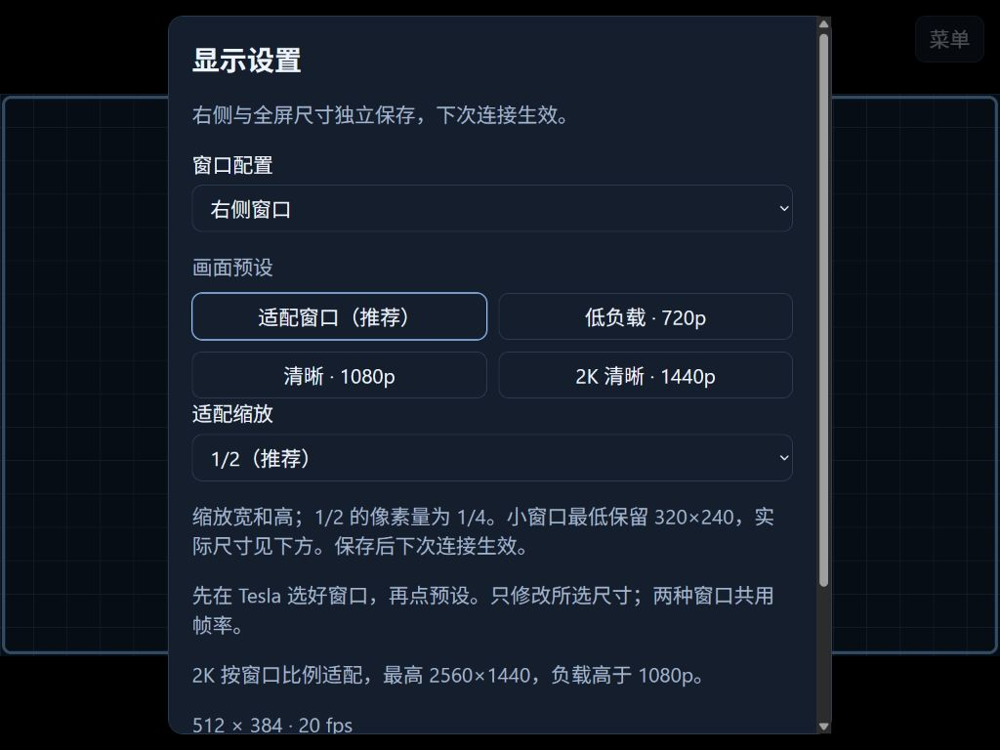
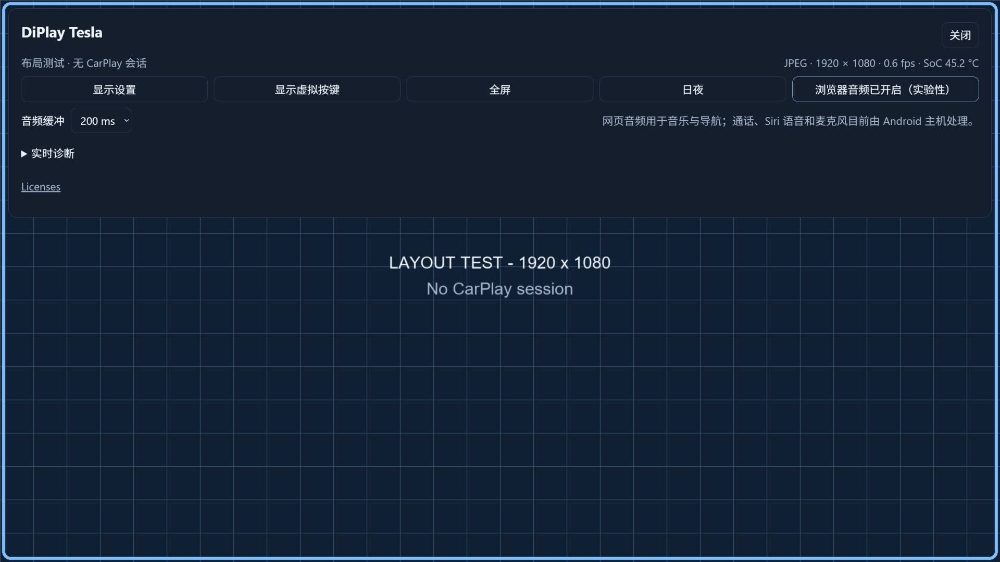
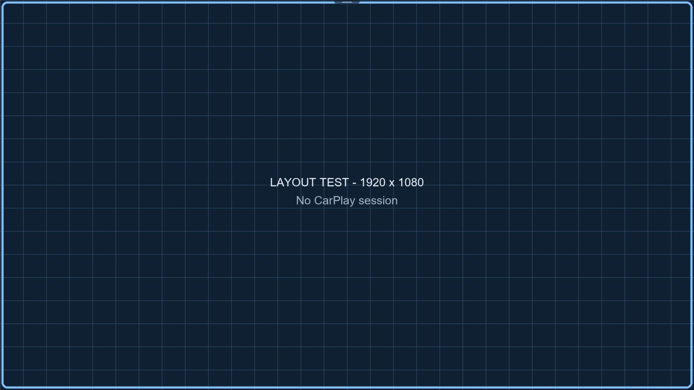
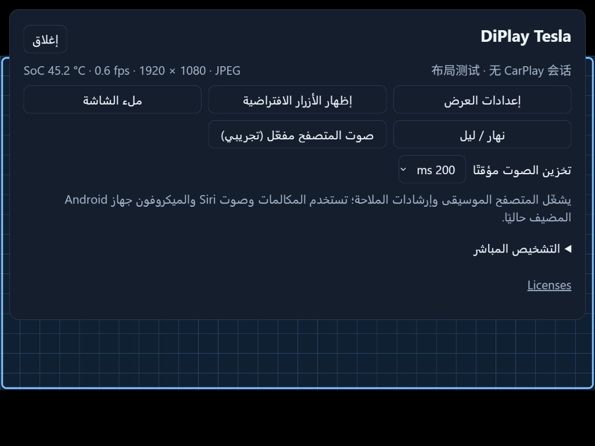
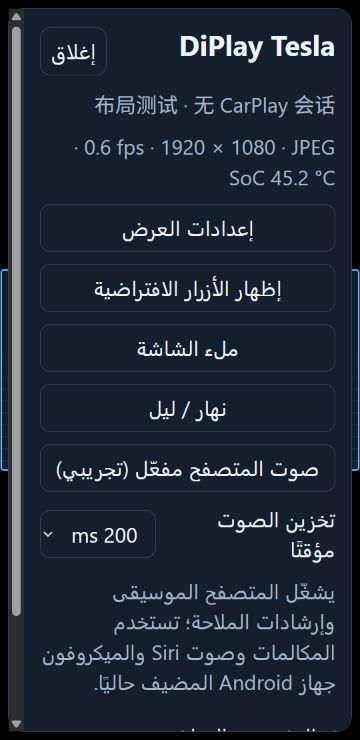
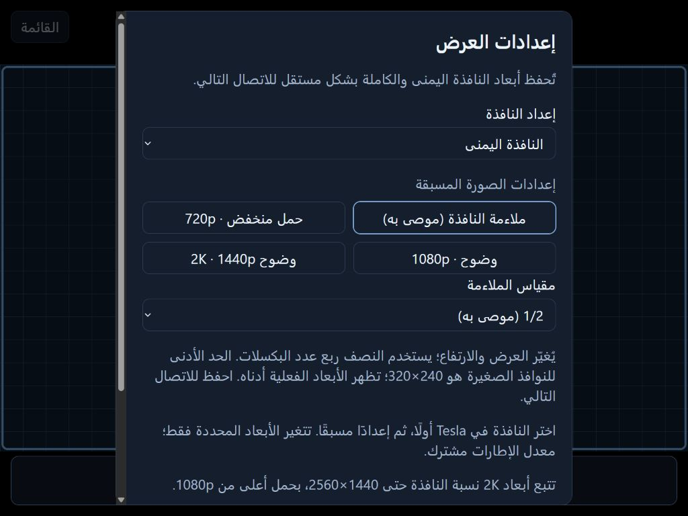
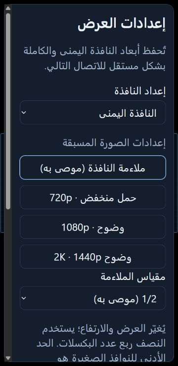

# Tesla 显示预设与屏幕资料

0.1.7 的网页显示设置默认只显示窗口配置和四个预设，宽高、帧率、JPEG 画质与传输选项收在“手动调整”中。先在 Tesla 车机选择实际的右侧或全屏窗口，再打开显示设置，选择同名配置和预设，最后保存。保存不会中断正在运行的 CarPlay；需要立即应用时，再点击“应用并重新连接”。

| 预设 | 尺寸策略 | 帧率 | JPEG 回退画质 |
| --- | --- | --- | --- |
| 适配窗口（推荐） | 先按窗口与像素密度计算，最高 1920×1080；再缩放为 1/2（默认）、3/4 或 1× | 20 fps | 80 |
| 低负载 · 720p | 保持当前窗口比例，最高 1280×720 | 15 fps | 70 |
| 清晰 · 1080p | 保持当前窗口比例，填到最高 1920×1080，可比小窗口的自动尺寸更大 | 20 fps | 85 |
| 2K 清晰 · 1440p | 保持当前窗口比例，填到最高 2560×1440，负载高于 1080p | 20 fps | 85 |

这些是视频输出上限，不是对整块 Tesla 面板的原生分辨率声明。例如 2K 预设在 16:9 全屏得到 2560×1440，在 4:3 右侧窗口得到 1920×1440，在 8:9 右侧窗口得到 1280×1440。宽高取偶数，保留窗口比例。只修改所选窗口的尺寸，另一窗口的尺寸保留；帧率和 JPEG 画质是两种窗口共用的设置。JPEG 画质不改变 WebRTC 的编码码率。

“适配窗口”读取的是浏览器可用区域，像素密度最多按 2 倍计算，再按输出上限缩小。它不会用整屏尺寸除以二来猜右侧窗口，也不会自动切换 Tesla 的窗口模式。切换车机窗口后，需要重新选择预设并保存。手动分辨率仍可设到 2560×1440；这不表示该尺寸已经在实车验证。

缩放在上述上限计算之后进行，1/2 使宽和高各减半，像素总量为四分之一；例如
1232×1080 变为 616×540，1920×1080 变为 960×540。小窗口会停在编码器最低
宽 320、高 240 的限制，并尽量保持比例；下方摘要显示真正将保存的尺寸。右侧与
全屏缩放选择保存后分别记在当前浏览器，取消不会改变选择。另一浏览器和 HTTP/HTTPS
来源拥有各自的偏好；最终宽高仍保存到 Android 的同一组配置。

浏览器的 `devicePixelRatio` 受显示缩放和页面缩放影响，并不直接表示车机面板规格。
例如可用区域 1420×1244、DPR 1.5 时，先得到 2130×1866，再压到 1080 高并取偶数，
得到 1232×1080。这个尺寸同时受窗口比例影响，不能只归因于 Windows 缩放。
参见 [MDN devicePixelRatio](https://developer.mozilla.org/en-US/docs/Web/API/Window/devicePixelRatio)。

本机 HTTPS 入口与显示功能独立，配置方法见
[Android root gateway](../proxy/android-root/README.md)。具体部署数据不放在公开文档中。

## 官方屏幕资料

检索日期：2026-10-11。不同市场、配置和生产时间可能有差异，下面仅记录对应资料确认的尺寸。

| 对应资料 | 前排屏幕尺寸 | 来源 |
| --- | --- | --- |
| 早期 Model Y | 15 英寸，横屏 | [Tesla Model Y 应急指南](https://www.tesla.com/sites/default/files/downloads/Model_Y_Emergency_Response_Guide_en.pdf) |
| 2025 年推出的 Model 3 / Model Y Standard | 15.4 英寸 | [Tesla 2025 Q3 更新](https://ir.tesla.com/_flysystem/s3/sec/000162828025045861/tsla-20251022-gen.pdf) |
| 当前美国 Model Y，包括 Premium / Performance | 16 英寸 | [Tesla Model Y 规格](https://www.tesla.com/modely) |
| 当前美国 Model 3 Premium | 16 英寸 | [Tesla Model 3 规格](https://www.tesla.com/model3) |
| Cybertruck | 18.5 英寸 | [Tesla Cybertruck 规格](https://www.tesla.com/cybertruck-delivery-event) |

用户的目标车型是 **2026 Model Y Juniper**。补充检索发现，[2026 年 1 月 6 日的中国市场改款报道](https://www.ithome.com/0/910/728.htm)明确称前排屏幕升级为 16 英寸 2K；这是媒体报道。Tesla 的[新 Model Y Performance 官方介绍](https://www.tesla.com/en_gb/blog/introducing-new-model-y-performance)确认 16 英寸高分辨率屏幕较当时其他版本的 15.4 英寸屏幕增加近 80% 像素；该介绍针对欧洲 Performance，不代替中国全部配置的参数。上次仅列英寸数、预设只提供到 1080p，遗漏了 2K 档。

2K 预设采用 2560×1440 输出上限。面板尺寸与网页可用区域是两回事，右侧窗口和全屏都按车内浏览器现场比例计算，避免拉伸或猜测固定半屏尺寸。尚未在目标 Tesla 实车上验证 2K 画面和持续性能。

## 网页音频与语音的区别

0.1.10 默认开启浏览器音频，现有 PCM 通道转发音乐与导航播放；浏览器要求用户手势时，点一下页面会尝试启动声音。手动关闭会被本浏览器记住。通话、Siri 语音和麦克风目前仍由 Android 主机处理；网页上的 Siri 按键可以发起 Siri，但不提供网页语音通道。这里的 Android 指安装 DiPlay 的主机，不是要求更换 iPhone。

当前网页没有麦克风采集或音频回传实现，Android 的麦克风采集和 CarPlay 上行仍走原有路线。网页播放声音不需要麦克风权限；采集声音则需要受信任的 HTTPS 等安全上下文、浏览器支持和用户授权。[MDN getUserMedia 文档](https://developer.mozilla.org/en-US/docs/Web/API/MediaDevices/getUserMedia)列出了这些条件。电脑的 localhost/127.0.0.1 是安全上下文特例，不能证明车内局域网 HTTP 地址也可以采集麦克风。HTTPS 是前提之一，是否能使用 Tesla 车内麦克风仍需实车验证。

本次 V50 检查中 `media.audio_flinger` 服务不可用；之前的原生 AudioTrack 初始化也失败。因此 Android 语音路线的存在不代表这台 V50 已能完成通话或 Siri 音频。浏览器媒体音频与语音双向通道应分别验证。

## 公开界面图片

以下截图来自实际网页资源配合本机模拟服务，字体为 130%。背景为合成测试网格，没有接入真实 iPhone 或车辆。图中没有真实账号、音乐库、导航位置、车牌、车辆标识、网络地址或配对凭证；它们展示界面布局，不作为 CarPlay 或实车性能证据。

