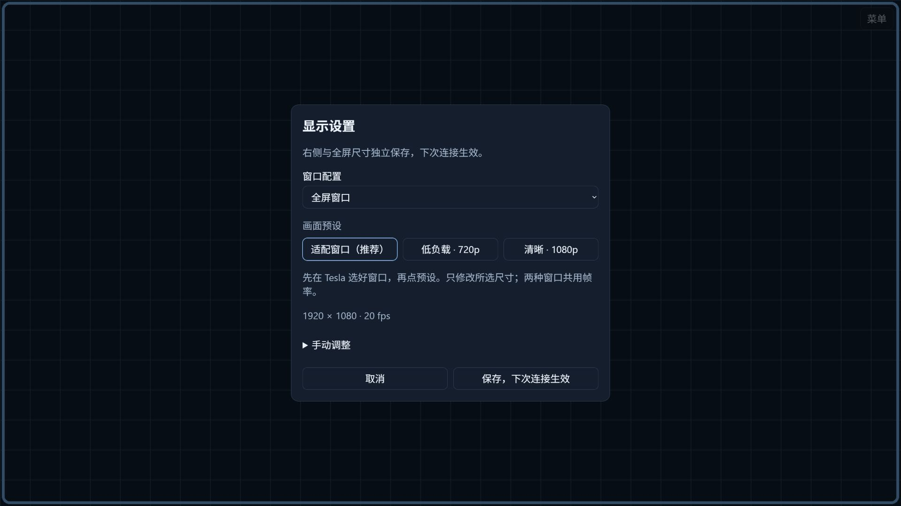
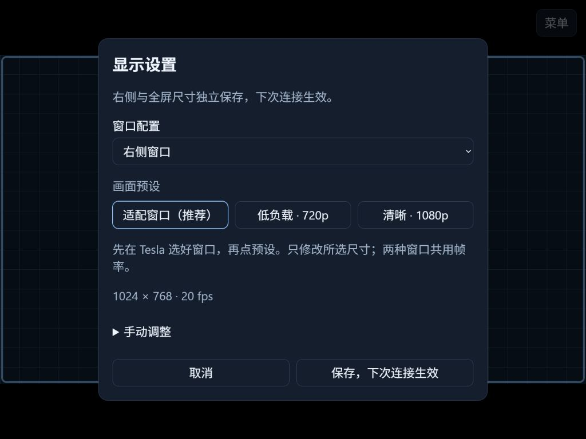
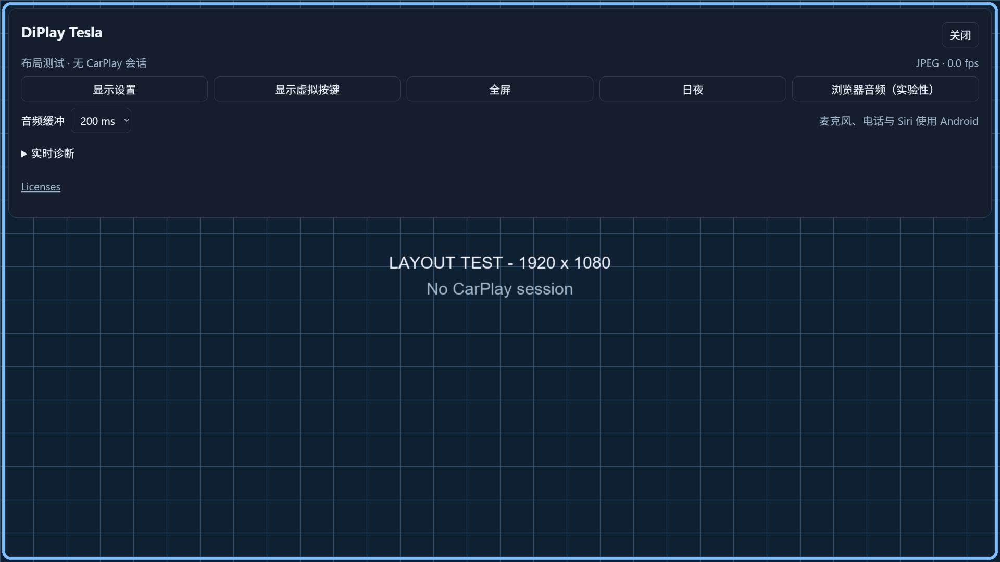
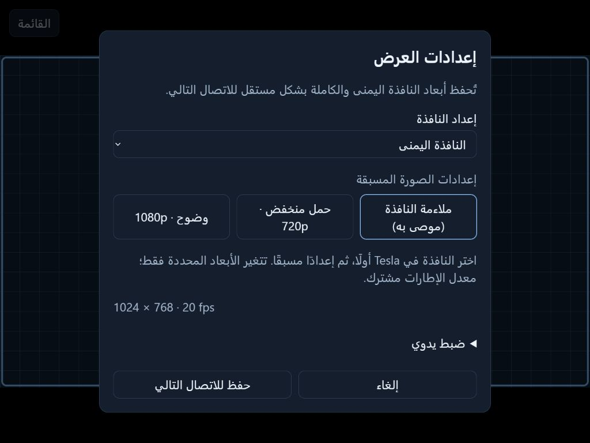
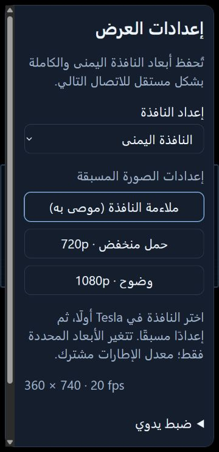

# Tesla 显示预设与屏幕资料

0.1.5 的网页显示设置默认只显示窗口配置和三个预设，宽高、帧率、JPEG 画质与传输选项收在“手动调整”中。先在 Tesla 车机选择实际的右侧或全屏窗口，再打开显示设置，选择同名配置和预设，最后保存。保存不会中断正在运行的 CarPlay；需要立即应用时，再点击“应用并重新连接”。

| 预设 | 尺寸策略 | 帧率 | JPEG 回退画质 |
| --- | --- | --- | --- |
| 适配窗口（推荐） | 按当前可用窗口和浏览器像素密度计算，最高 1920×1080 | 20 fps | 80 |
| 低负载 · 720p | 保持当前窗口比例，最高 1280×720 | 15 fps | 70 |
| 清晰 · 1080p | 保持当前窗口比例，填到最高 1920×1080，可比小窗口的自动尺寸更大 | 20 fps | 85 |

这些是视频输出上限，不是对整块 Tesla 面板的原生分辨率声明。例如 4:3 的右侧窗口选择清晰预设会得到 1440×1080，而不是被拉伸成 1920×1080。宽高取偶数，保留窗口比例。只修改所选窗口的尺寸，另一窗口的尺寸保留；帧率和 JPEG 画质是两种窗口共用的设置。JPEG 画质不改变 WebRTC 的编码码率。

“适配窗口”读取的是浏览器可用区域，像素密度最多按 2 倍计算，再按输出上限缩小。它不会用整屏尺寸除以二来猜右侧窗口，也不会自动切换 Tesla 的窗口模式。切换车机窗口后，需要重新选择预设并保存。手动分辨率仍可设到 2560×1440；这不表示该尺寸已经在实车验证。

## 官方屏幕资料

检索日期：2026-10-11。不同市场、配置和生产时间可能有差异，下面仅记录对应资料确认的尺寸。

| 对应资料 | 前排屏幕尺寸 | 来源 |
| --- | --- | --- |
| 早期 Model Y | 15 英寸，横屏 | [Tesla Model Y 应急指南](https://www.tesla.com/sites/default/files/downloads/Model_Y_Emergency_Response_Guide_en.pdf) |
| 2025 年推出的 Model 3 / Model Y Standard | 15.4 英寸 | [Tesla 2025 Q3 更新](https://ir.tesla.com/_flysystem/s3/sec/000162828025045861/tsla-20251022-gen.pdf) |
| 当前美国 Model Y，包括 Premium / Performance | 16 英寸 | [Tesla Model Y 规格](https://www.tesla.com/modely) |
| 当前美国 Model 3 Premium | 16 英寸 | [Tesla Model 3 规格](https://www.tesla.com/model3) |
| Cybertruck | 18.5 英寸 | [Tesla Cybertruck 规格](https://www.tesla.com/cybertruck-delivery-event) |

用户的目标车型是 **2026 Model Y Juniper**。当前 Model Y 官方页面列出 16 英寸屏幕，但上述可核实的官方资料没有给出这辆车的原生像素数或浏览器在右侧、全屏时的精确可用尺寸。因此预设以车内浏览器现场读到的窗口为准，不把未经确认的 2560×1440 或固定半屏尺寸标成官方参数。

## 公开界面图片

以下截图来自实际网页资源配合本机模拟服务，字体为 130%。背景为合成测试网格，没有接入真实 iPhone 或车辆。图中没有真实账号、音乐库、导航位置、车牌、车辆标识、网络地址或配对凭证；它们展示界面布局，不作为 CarPlay 或实车性能证据。

