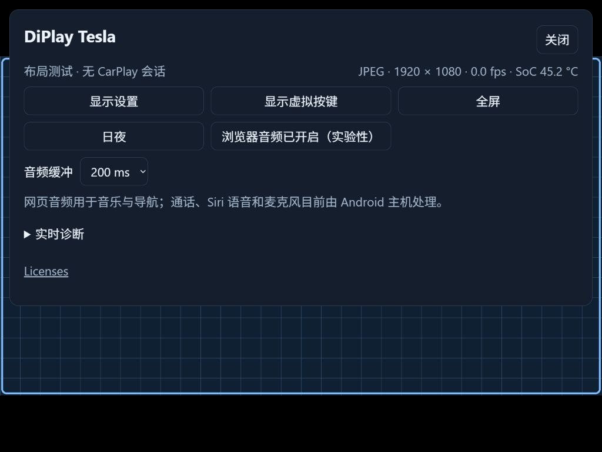
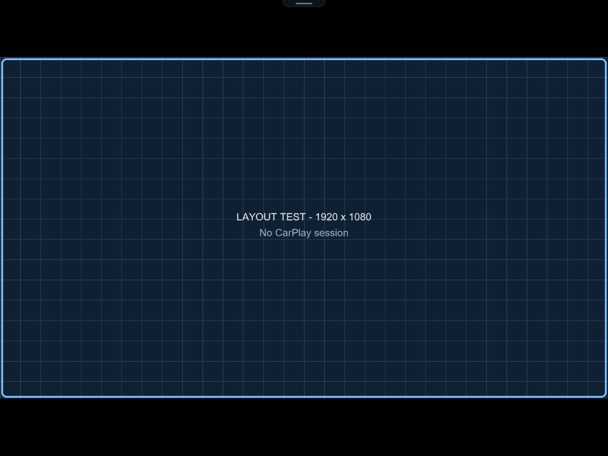
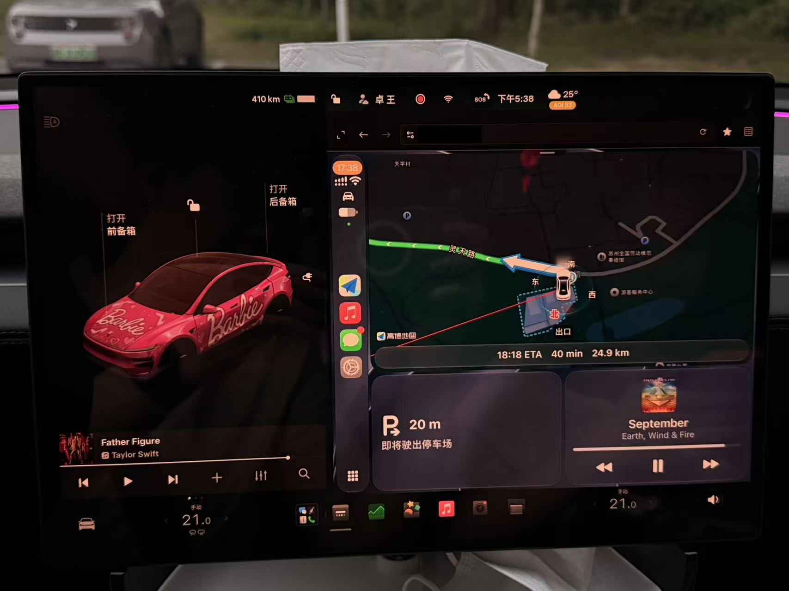

# DiPlay Tesla 使用指南

DiPlay Tesla 安装在 Android 主机上，iPhone 连接这台主机，Tesla 浏览器负责显示 CarPlay、触控和播放音乐／导航声音。以下步骤适用于 **0.1.10**。

[下载 0.1.10](https://github.com/WangZhuo2015/DiPlay-tesla/releases/tag/tesla-v0.1.10) · [English](TESLA-QUICKSTART.md) · [技术与构建说明](TESLA.zh-CN.md)

## 下载哪一个文件

| 文件 | 用途 |
| --- | --- |
| `DiPlay-Tesla-0.1.10.apk` | 安装到 Android 主机的完整连接版，包含实验性 CarPlay 认证身份，无需自己编译 |
| `DiPlay-Tesla-Proxy-0.1.10.zip` | 独立网关源码、HTTPS 配置模板和生成工具；需要 HTTPS 时参考其中说明 |
| `SHA256SUMS.txt` | 核对以上文件的 SHA-256 |
| GitHub 自动生成的 Source code | 项目源码；普通源码构建不含 CarPlay 认证身份 |

APK 支持 Android 7.1+（API 25+），设备需要允许安装 APK。Android 7.1–8.1 和不同厂商的无线连接能力还需要各自验证。APK 的包名为 `com.diplay.tesla`；同签名版本可以覆盖安装，保留设置与配对。不要先卸载旧版。`.debug` 包与正式包分开安装，设置也各自保存。

准备一台能连接 iPhone、并供车机访问的 Android 主机；无线连接需要蓝牙和可用的 Wi-Fi 热点／网络。Tesla 应连接这台主机提供的热点，或与主机处于能够互通的同一局域网。网络应能够提供互联网，避免车机自动切回其他网络。

## 1. 安装并连接 iPhone

1. 在 Android 主机安装 APK，打开 **DiPlay Tesla**。按系统提示授予蓝牙／附近设备等连接权限；较旧 Android 可能需要位置权限。麦克风权限只用于 Android 端的 Siri／通话路线。
2. 打开 Android 主机的热点，设备支持时选择 5 GHz。不要为了更新 APK 重新设置热点名称和密码。
3. 在 DiPlay 打开 **设置 → 连接 → 连接设置 → 车载热点**，填写这台 Android 主机热点的准确名称与密码。这里的“车载热点”指接收 CarPlay 的 Android 主机热点。
4. 保持 iPhone 蓝牙和 Wi-Fi 开启。在 iPhone 的 **设置 → 蓝牙** 与 Android 主机配对，再在 DiPlay 选择相应 iPhone，点击 **连接手机**。iPhone 提示使用 CarPlay 时接受。兼容设备会通过蓝牙握手交付热点信息。
5. 等待 DiPlay 显示 CarPlay 已连接。Tesla 版主要将视频输出到浏览器，Android 上没有重复显示完整 CarPlay 画面是正常行为。

无线 CarPlay 与供 Tesla 使用的热点能否同时工作取决于主机固件。当前 V50 已完成无线连接测试；其他设备若不能同时工作，可改用 iPhone 的 USB 数据线，或使用外部路由器的[现有 Wi-Fi／同一局域网模式](EXISTING_WIFI.md)。USB 需要数据接口与数据线，按提示允许 USB 及本地 VPN 连接。

## 2. 第一次配置 HTTPS

**APK 不附带任何用户的 HTTPS 域名、证书、证书私钥、热点密码或设备路由配置。** 新主机必须自行配置入口，不能只安装 APK 就得到可访问的 HTTPS 域名。已配置过的主机通常可以继续使用原入口，但应检查上游端口。

本仓库提供两种独立网关：

| 场景 | 配置说明 |
| --- | --- |
| 已 root 的 Android 热点主机，网关也运行在这台主机 | [Android 本机 HTTPS 入口](../proxy/android-root/README.md) |
| 在电脑、路由器或其他可运行 Node.js 的设备上提供 HTTPS | [独立 proxy](../proxy/README.md#https-browser-gateway-011) |

Android 本机方案的准备顺序：

1. 准备自己控制的域名和浏览器信任的有效 HTTPS 证书链、私钥，配置自己的 DNS 解析，使车辆经热点能到达该入口地址。
2. 在 DiPlay **设置 → 连接 → Tesla 浏览器（实验性）**查看实际 HTTP 地址和端口。默认从 8080 开始尝试，固件占用时使用后续端口；网关的本机上游填写实际的 `http://127.0.0.1:端口`。
3. 根据主机架构安装 Caddy，用 `proxy/android-root/config.example.json` 生成自己的配置，验证后按网关说明部署。Caddy 不包含在 APK 或 proxy ZIP 中；Node.js 只负责在电脑生成配置，无需在 Android 上运行。
4. 安装生成的入口元数据，让 DiPlay 连接页显示自己的 HTTPS 域名。该元数据仅负责显示地址，仍需要 DNS、证书和代理正常工作。
5. 让 Tesla 连接 Android 热点，打开 `https://自己的域名`；使用非 443 端口时写上 `:端口`。所有路由配置在 Android／网关端完成，车机只需连接热点并打开网页。

JSON 模板中的域名和地址是占位值，必须替换。证书到期前自行续期，并按网关说明重启代理。实际配置、生成文件、证书和日志保存在本地忽略目录，不要提交 GitHub。HTTPS 证书与 iPhone 的 CarPlay 认证身份是两套独立用途的资产。

Android 服务本身提供 HTTP；把 `http://主机IP:端口` 直接改成 `https://` 不会启用 TLS。HTTP 可用于可信局域网排查。Tesla 是否允许访问该 HTTP 地址取决于固件，正式入口应使用配置好的受信任 HTTPS。

### Tesla 内网 IP 访问限制

部分 Tesla 固件会限制浏览器访问 RFC1918 内网地址，包括 `10.0.0.0/8`、`172.16.0.0/12`、`192.168.0.0/16`。热点已连接、电脑／手机能打开页面，车机仍可能显示拒绝访问或连接失败。[Tesla Android 开发者的部署记录](https://github.com/tesla-android/tesla-android.github.io/blob/main/install-guide-2022-18-1.md#ip-address-range)描述了这一限制；具体行为随固件和网络而异。

因此，给内网 IP 加一个域名或 HTTPS 证书不保证可以访问；域名仍指向受限地址时，问题可能继续存在。按自己的网络规划配置车机可达且固件允许的入口地址、DNS、证书和 Android 本机网关，再从车机验证。公开模板的域名／地址仅作占位，不能直接当成可用入口；电脑的 `127.0.0.1` 测试也不能替代这一步。

## 3. 车机打开页面与配对

1. 在 Tesla 的 Wi-Fi 设置连接 Android 主机热点。确认 Android 的 DiPlay 仍在运行。
2. 在 Android 打开 **设置 → 连接 → Tesla 浏览器（实验性）**。弹窗中显示入口地址和 **6 位数字配对码**；“复制浏览器链接”也可复制带短码的链接。
3. 在 Tesla 浏览器打开该入口，输入 6 位码并点 **连接**。码有效期为五分钟，过期或输错五次后重新打开 Android 的这项设置获取新码。
4. 配对后该浏览器会记住连接，通常再次打开不需要重复输入。清除浏览器数据、卸载 Android 应用，或更换 HTTP／HTTPS 来源后可能需要重新配对。
5. 若页面显示“等待 CarPlay”，说明网页已经打开，但 iPhone 会话还未建立；回到 Android 先完成第 1 步连接。若原网页停在旧错误页，重新输入入口网址加载页面。

不要公开配对码或含短码的链接。它们与首次 iPhone 蓝牙配对是不同步骤。

## 4. 选择右侧／全屏与清晰度

先用 Tesla 自己的窗口控制选好右侧或全屏。点击网页 **顶部中央小把手 → 显示设置**，选择对应的 **右侧窗口／全屏窗口**配置，然后选择预设。

| 预设 | 建议用途 |
| --- | --- |
| 适配窗口 · 1/2 | 建议先选；按当前窗口比例计算，宽高各减半，像素量是 1× 的四分之一 |
| 适配窗口 · 3/4 或 1× | 在同一窗口逐步提高细节 |
| 低负载 · 720p | 主机较慢、网络抖动或温度较高时比较效果 |
| 清晰 · 1080p | 兼顾细节与负载 |
| 2K 清晰 · 1440p | 最高 2560×1440，适合尝试高分辨率屏幕；负载高于 1080p |

预设保留实际浏览器窗口的比例，右侧窗口的 2K 输出不一定是 2560×1440。右侧和全屏尺寸分别保存，帧率共用。选配置不会替 Tesla 切换系统窗口模式。

点击 **保存** 后，新尺寸在下次 CarPlay 连接生效，正在播放的会话不会自动中断；需要立即生效时，再明确选择 **应用并重新连接**。更新 APK 也不会自动把原来的分辨率改成 1/2。每次切换车机窗口后，检查对应配置和预设，再保存／重连。

摘要中的宽×高与 fps 是实际收到的画面和解码帧率；设置中的 fps 是请求值。静止页面实际 fps 降到 0 可以是正常行为。浏览器窗口大小、系统缩放和页面缩放会影响适配尺寸，不能直接把检测值当成物理屏幕分辨率。参数范围和示例见[显示预设说明](TESLA-DISPLAY-PRESETS.md)。

## 5. 声音与菜单

0.1.10 **默认开启浏览器音频**。配对后播放音乐；浏览器要求用户手势时，点一下页面即可尝试启动声音。若之前在这个浏览器手动关闭过，点顶部把手展开菜单，再打开 **浏览器音频（实验性）**。关闭选择会在本浏览器记住，刷新／重连仍保持关闭。

浏览器接收音乐和导航声音，默认缓冲 200 ms；声音断续可先试 400 ms，稳定后再比较 80 ms。增加缓冲会增加延迟。页面转入后台、音频上下文暂停或连接失效时，浏览器停止接管，后续音频退回 Android 路线。保持 CarPlay 页面在前台。

**通话、Siri 语音和麦克风仍使用 Android 主机。** 网页 Siri 按键可以发起 Siri，网页目前没有麦克风采集和语音回传。没有可用音频／麦克风硬件的主机，不能仅凭网页音乐正常就认为通话也能使用。

菜单把手位于顶部中央，闲置约两秒收起；点顶边露出的部分即可展开。虚拟按键默认隐藏，需要时在菜单打开。**实时诊断**与菜单摘要显示视频路线、实际分辨率、fps、音频缓冲和可读的热传感器；没有可用温度则显示未知，电池广播不再作为温度来源。

以下是合成布局截图，不含真实账号、车辆、导航位置或网络配置：

## 常见问题

| 现象 | 先检查 |
| --- | --- |
| HTTPS 完全打不开 | Tesla 是否连接正确热点；自己的 DNS、网关服务、证书及实际上游端口。安装 APK 不会自动创建 HTTPS 入口 |
| 手机／电脑可打开，Tesla 拒绝访问 | 检查入口解析是否落到车机限制的内网 IP；按上面的内网 IP 说明检查网关地址与车辆侧可达性 |
| 出现证书报错 | 证书覆盖的域名、有效期、完整证书链和设备时间；按自己的配置修复 |
| 找不到验证码／码失效 | Android 的“设置 → 连接 → Tesla 浏览器（实验性）”；重新打开取得新码 |
| 网页打开但一直等待 CarPlay | iPhone 是否已连上 Android，热点名称／密码、蓝牙配对和权限是否正确 |
| 提示无法加载 CarPlay 认证 | 是否装了完整连接 APK；0.1.0／0.1.1 和普通源码构建没有内置身份 |
| 菜单图标有按下动画但不切换 | 确认安装 0.1.10，并刷新 HTTPS 页面加载当前 APK 资源；代理不要使用旧项目静态页面 |
| 有画面但没声音 | 播放一首音乐、点页面允许播放；检查是否记住了手动关闭，查看菜单音频状态与车机音量 |
| 声音一顿一顿 | 保持页面前台，先试 400 ms 缓冲；每次只调整一项 |
| 模糊或延迟明显 | 核对窗口配置，先从适配 1/2、20 fps 开始；较慢主机试 720p／15 fps，逐步提高 |
| 显示 JPEG 而非 WebRTC | WebRTC 或 H.264 解码没有建立，会自动回退；车辆和 Android 必须可直接通信，HTTPS proxy 不提供 UDP 中继 |

复现后可查看网页实时诊断，并在 Android **设置 → 诊断 → 保存诊断报告**导出。分享前移除个人信息、热点密码和配对信息。

## 已验证的范围

用户于 2026-10-12 补充确认 **0.1.10 已在 2026 Model Y Juniper 实车测试，音频、触摸均正常**。

| 项目 | 实测设备／结果 |
| --- | --- |
| 车辆 | 2026 Tesla Model Y Juniper |
| Android 主机 | ZTE V50 移动 WiFi |
| iPhone | iPhone 16 Pro Max、iPhone 17 Pro Max |
| iOS | 两台手机均为 iOS 27.0.1 |
| 功能 | 车机浏览器 CarPlay 音频、触摸正常 |

V50 此前的无线 iPhone／HTTPS 测试还确认了默认音频、顶部把手收起和图标切换。长时间 2K 性能及通话／Siri 没有在这次反馈中单独验证，其他车型和固件需要分别测试。

此版本包含明确配置的实验性配件身份，可以进行本地 iPhone 认证；它不是 Apple 为 DiPlay 新签发的身份。来源见[认证资产说明](THIRD_PARTY_NOTICES.md#experimental-authentication-data)。Android APK 签名私钥和用户 HTTPS 证书私钥不随包分发。

[实车验证记录](testing/tesla/README.md#model-y-juniper-vehicle-report--2026-10-12)包含设备组合、照片，以及此前的自动检查和截图。请停车完成设备、网络、声音和触控检查。
