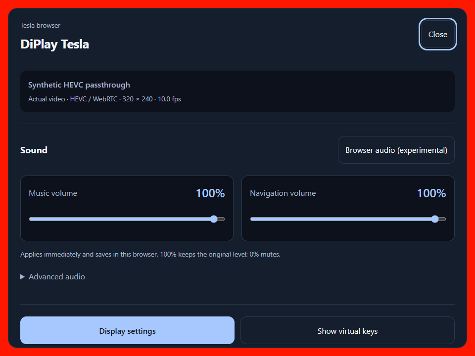

# HEVC passthrough development preview

Follow-up: [the V50 gateway-alias investigation](WEBRTC-ALIAS-2026-11-01.md) found and corrected
an older local-decoder guard that still downgraded the first preview's actual session to AVC,
despite the enabled HEVC preference. It also documents the separate WebRTC address mismatch.
The initial build/run record below is retained as recorded at that time.

The Tesla application now permits HEVC by default when no explicit owner preference exists.
A saved off preference is respected. Advanced settings use the same HEVC persistence and
defer changes until the next CarPlay connection. Advertising HEVC permits the iPhone to choose
it; the actual codec is taken from the received configuration, not inferred from the switch.

AVC and HEVC use the existing encoded-frame queue and native libdatachannel RTP/DTLS/SRTP
transport. HEVC adds hvcC validation, VPS/SPS/PPS forwarding, profile/tier/level signaling,
HEVC random-access detection and RASL suppression after joining at a random-access picture.
Android does not decode or transcode this video path.

The default WebRTC browser mode never requests JPEG frames during startup or recovery.
JPEG remains an explicit H.264-only diagnostic mode. HEVC configuration and frames never
enter the JPEG decoder. The browser checks HEVC receive capability when available and also
checks SDP rejection. An unsupported receiver opens the menu with instructions to disable
HEVC on Android and reconnect; it does not silently start JPEG conversion.

## Verification

- Final complete Android invocation: 3,668 tests; 3,659 passed, seven failed, two skipped.
  Failures are the three existing Windows symlink privilege cases and four existing
  FileProvider compatibility cases. All requested debug/release lint and assembly tasks passed.
- Browser Kotlin tests: 92 passed. Tesla tests: 14 passed. HEVC parsing, malformed records,
  AVC compatibility, random access/RASL and zero JPEG delivery are covered.
- Node browser/proxy tests: 101 passed.
- Local Chrome production-asset checks passed at full, compact and Arabic RTL viewports with
  font scale 1.3: pairing, volume controls, display settings, real AVC loopback, zero automatic
  JPEG requests and visible HEVC incompatibility handling.
- Real native HEVC test: PC-generated 320×240 / 10-fps HEVC bytes were relayed by an Android 29
  emulator through the application’s actual native H.265 RTP/DTLS/SRTP stack. Desktop Chrome
  156.0.8078.74 decoded 119 frames over the observation window and reported 10.0 fps. A decoded
  pixel was `[255, 24, 0, 255]`, matching the synthetic red source within the test threshold.
  The Android test passed and counted zero calls to its JPEG sink. It creates no Android
  video encoder or decoder. Both H.264 and HEVC branches remain available.



The small synthetic clip validates protocol and decode correctness, not sustained high-resolution
performance. No iPhone HEVC session or Tesla browser HEVC reception was tested in this run.
V50 was offline; the owner chose to complete the code and APK without another device installation.
The final APK retains the installed release signing certificate. It is a local 0.1.13 / code 14
HEVC preview, not an updated GitHub release.

## Reproduce the native sender test

Build `:browser:assembleDebugAndroidTest`, install the test APK, then run:

```sh
adb shell am instrument -w -e class com.diplay.browser.HevcPassthroughInstrumentedTest \
  com.diplay.browser.test/androidx.test.runner.AndroidJUnitRunner
```

During its bounded lifetime, connect an external browser to the test server at port 8098 with
the synthetic test token documented in the test source. Decode the supplied HEVC clip, then
send its `home` test action to confirm playback. The emulator run used explicit UDP forwarding
for port 40001 and the `loopbackIce=true` test argument. Those test-only substitutions are not
used by the production peer. The test source is under `browser/src/androidTest/` and the
reproducible synthetic assets under `browser/src/androidTest/assets/hevc/`.

Detailed immutable run logs and APK receipts are retained in the local ignored
`agent_docs/hevc-20261031/` and private release directories. Full CI remains red for the
explicit Windows cases above; no tests were disabled or rewritten to remove those failures.

## Network boundary

HEVC does not resolve the Tesla private-address restriction. The browser must still reach the
advertised media addresses, or a media relay must be provided. The current HTTPS gateway handles
HTTP/WebSocket traffic and does not add a TURN service or a UDP relay.
