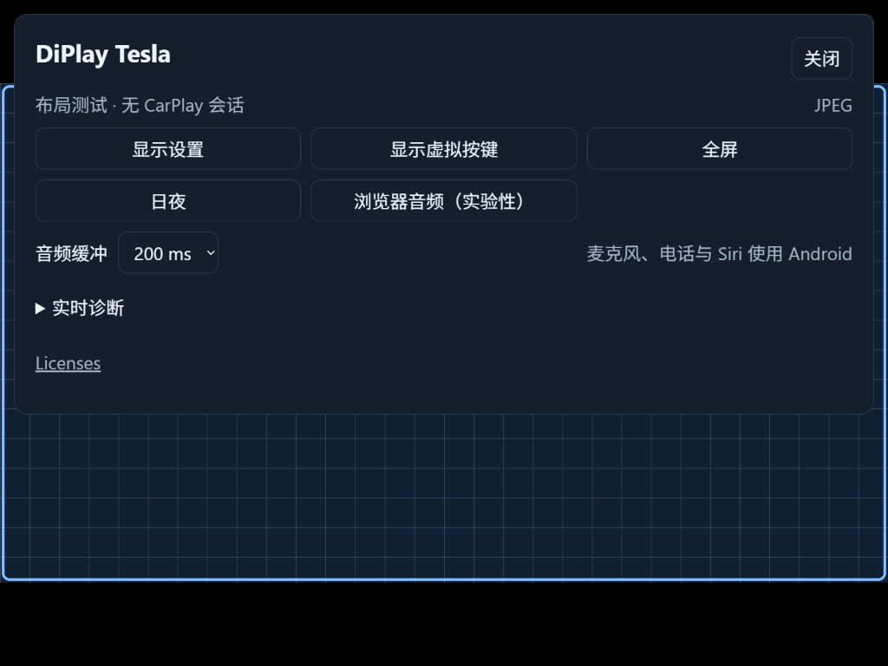
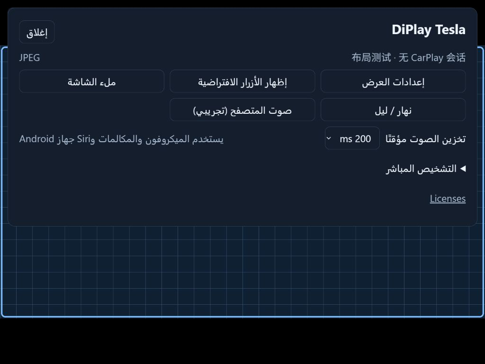
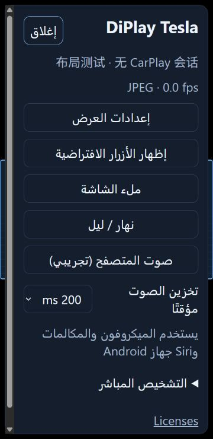
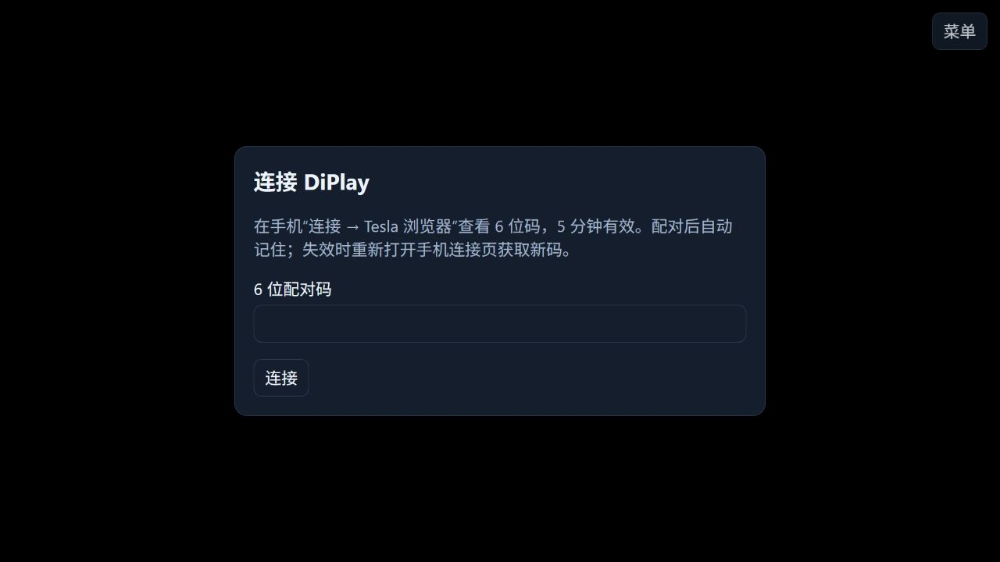

# Tesla port verification

## 0.1.12 standalone debug prerelease — 2026-10-30

A provisioned **0.1.12 / versionCode 13** APK was built from exactly
`ed62af2a5aac2dc40c0aeb996046a2bc498370f2`, using the existing debug signing key
and the previously selected Tesla 0.1.10 external authentication input. It is
`com.diplay.tesla.debug`: a separate test application that cannot update or inherit
data from the original release. No new signing key was generated.

The single-worker, low-priority standalone build and selected tests/lint completed
with `BUILD SUCCESSFUL in 51s`. Tesla tests passed **12/12**; browser **82/82**
results for unchanged source were reused as `UP-TO-DATE`. Tesla/browser lint had
zero errors/fatal issues and 27 warnings (17/10). The Node suite was freshly run:
**92 passed, zero failed/skipped**. Package/version, APK signature, existing signer
fingerprint, three RTC ABIs and the exact two authentication entries were verified.
Authentication bytes match the original selected 0.1.10 APK; no additional private
key/certificate or signing-keystore container is bundled.

The APK is **46,361,711 bytes**, SHA-256
`ff0d1b3f6a15fc72794636cbdc287a097238481c7dd86a10a588fcdbc19ea011`.
[Machine-readable artifact verification](standalone-debug-0.1.12-20261030.json)
contains public metadata only. The release tag additionally includes documentation
updates; product code is unchanged from the recorded build source. The earlier full
Android gate below remains failed (three host dual-stack cases and one skip); it
was not rerun or disabled. No physical-device, ADB or GUI validation was performed.
[Download and limitations](../../RELEASE-NOTES-TESLA-0.1.12.md).

## Version preparation — 0.1.12 / versionCode 13 — 2026-10-30

The user selected **0.1.12**. Remote release/tag checks still show the published
0.1.10 package (code 11), with 0.1.11/code 12 on `main`; no 0.1.11 or 0.1.12
release/tag exists. The local candidate is now 0.1.12/code 13. Historical APK
metadata, hashes and exact-commit test results below remain unchanged.

Only version/documentation preparation was performed in this step. No Android
build, test, lint, ADB or GUI run was started while audio API testing has priority.
The next standalone build must use the already authorized Tesla 0.1.10 external
authentication input and verify its identity/content. The original Android release
signing key remains unavailable, and acceptance of a separate debug package is
still pending; no replacement release key, push or publication was performed.
[Current release candidate and remaining checks](../../RELEASE-NOTES-TESLA-0.1.12.md).

## Release integration preparation — 2026-10-30 (not published)

The isolated preparation branch combines current `main` (`f39ab328`) with performance
PR #5 head `b4493e635072f07f5cf69a39af07e0cf15635579` and the navigation/video-status
implementation originally committed as `9904b44c`. Existing branches/checkouts are preserved.

Two overlaps were resolved: `app.js` retains the performance branch's `presentJpegFrame`
path and feeds measured dimensions/FPS only after a frame is shown; `BrowserServerTest`
retains both authenticated JPEG-demand checks and navigation range/conflict checks, with
an additional assertion that navigation controls do not renew JPEG demand. The bounded
encoder/queue implementation remains unchanged from PR #5; no extra frame copy was added.

Lightweight integrated validation: **92/92 Node browser/proxy tests passed**, all browser
JavaScript syntax checks passed, and public-source/diff checks passed.

The full Android task list was then run at exactly
`d5ecfac202b55da13886512e7b65f9008e825bc7`, after other Gradle builds were idle, using
one worker, `nice=10` and `--continue`. Gradle completed all requested phases in
**13m 14s** and returned failure for the two unit-test tasks containing the three
unchanged host-network failures documented below. No tests were disabled.

| Unit-test module | Tests | Passed | Failed | Skipped |
| --- | ---: | ---: | ---: | ---: |
| shared | 1,798 | 1,795 | 2 | 1 |
| common | 1,739 | 1,738 | 1 | 0 |
| home | 14 | 14 | 0 | 0 |
| browser | 82 | 82 | 0 | 0 |
| tesla | 12 | 12 | 0 | 0 |
| Total | **3,645** | **3,641** | **3** | **1** |

There were zero test errors. All five debug lint targets completed with **zero
errors/fatal issues and 56 warnings**. All four source-only debug APKs built and
passed APK signature verification; none contains `offline-mfi` authentication
assets or signing-keystore containers. The Tesla APK includes the native RTC library
for **arm64-v8a, armeabi-v7a and x86_64**. Its identity is `com.diplay.tesla.debug`,
version **0.1.11 / versionCode 12**, SHA-256
`1f91d077e4f7a044a29b9b7dd73ebb520fe6658aa75155345a030be5b3d4204d`.
It is a source-validation artifact without provisioned standalone authentication,
and its debug signature cannot update the original release. The complete Android
gate remains **not green** on this Mac. No product-code repair was needed.

[Machine-readable integrated Android result](release-integration-20261030.json)
records module totals, failures, lint and APK hashes. Gradle/test/native processes
were confirmed exited after verification; approximately **20.97 GiB** remained free.
No ADB, emulator, GUI capture, cache deletion or additional tool installation was used.
Earlier validation records below remain scoped to their own exact commits.

The latest checked PR #5 [CI run 41044572300](https://github.com/WangZhuo2015/DiPlay-tesla/actions/runs/41044572300)
is successful for exactly `b4493e63`; PR #5 is still open. No GitHub approval, merge,
push or Release was performed by this preparation task.

The existing authenticated private debug APK is from `9904b44c` and does not contain
PR #5. The new integrated source-only APK is not a final standalone or upgrade-compatible
release. Release signing still requires the original keystore; the provisioned
authentication input is separate. No new authenticated integration APK was generated.

The Chinese-first README draft removes the appended older BYD/general-app promotion
while retaining current identifiers and required license/author notices. Any new brand
or identifier change remains a user decision. [Current candidate release notes](../../RELEASE-NOTES-TESLA-0.1.12.md)
record the remaining publication limits.


## Browser navigation volume and visible video status — 2026-10-30 (unreleased)

Product implementation commit: `9904b44cc0600cc415d16a76f6a1486c75f547bd`, based on
`f39ab328`. The subsequent validation-record commit changes documentation only.
This work does not establish the cause of the reported V50/Tesla slowdown or extend
historical vehicle validation to the new controls.

### Android validation on this Mac

Installed official Temurin **25.0.5+8 arm64**, Android SDK **37.0 r2**, NDK
**28.2.13676358** and CMake **3.22.1**; reused Gradle **9.5.0** and Build-Tools
**36.0.0**. The required Android CI command was run with two workers. Its unit-test
phase failed on the unchanged host-network cases below. The remaining CI tasks were
then run separately with `--continue`, preserving the original failure reports.

| Unit-test module | Tests | Passed | Failed | Skipped |
| --- | ---: | ---: | ---: | ---: |
| shared | 1,798 | 1,795 | 2 | 1 |
| common | 1,739 | 1,738 | 1 | 0 |
| home | 14 | 14 | 0 | 0 |
| browser | 61 | 61 | 0 | 0 |
| tesla | 12 | 12 | 0 | 0 |
| Total | **3,624** | **3,620** | **3** | **1** |

No test errors were reported. The failures are:

- `AirPlayDualListenerTest.acceptsBothFamiliesOnTheSamePort`: accept timeout.
- `AirPlayTcpAcceptTest.bothAddressFamiliesReportOwnerAndOldCleanupPreservesNewListener`:
  no accepted TCP event.
- `CarPlayBonjourDualStackTest.dualLanThenSingleP2pThenDualLanServesAirPlayInfo`:
  expected HTTP response was absent.

Those network sources/tests are unchanged from `f39ab328`. An independent plain-Java
probe reproduced the `::1` accept timeout under both Temurin 25 and the pre-existing
JBR 21; IPv4 succeeded. This isolates an observable host IPv6 limitation without
asserting a particular system-permission or routing cause. No network settings were
changed and no tests were disabled. The skipped wildcard-port test reports that this
host permits wildcard and specific-address listeners to overlap. **The complete gate
is therefore not green on this Mac.**

Feature suites passed: navigation gain **21/21**, shared navigation settings **3/3**,
adaptive Android UI **69/69**, the HTTP server test including new authentication,
range and conflict cases **1/1**, and Tesla output tests **5/5**. No product-code repair
was needed after compilation/testing.

All five debug lint targets (`mobile`, `home`, `maphost`, `browser`, `tesla`) completed
with **zero errors/fatal issues** and **56 warnings**. Four ordinary debug APKs built
successfully and were checked to contain no `offline-mfi` assets. The native RTC
library built for **arm64-v8a**, **armeabi-v7a** and **x86_64**.

A separate **standalone debug** build also completed, with application output redirected
to a repository-external private directory. Its package is `com.diplay.tesla.debug`,
version **0.1.11 / versionCode 12**. APK signature verification passed. Its two authentication
entries match the explicitly selected **Tesla 0.1.10 release** byte for byte; no Android
signing-keystore container is bundled. Inputs, logs and APK remain local/private and
are excluded from Git. This debug-signed package **cannot update the original release**.
The original release keystore remains unavailable; no replacement release key was created.
No APK was uploaded or published. Disk free after validation was approximately **23.6 GiB**.

### Browser validation and remaining limits

- Browser/proxy Node regression suite: **82 passed, 0 failed, 0 skipped**.
  New cases cover serialized/coalesced gestures, stale reads, conflicting clients,
  uncertain writes, reconnect fencing, JPEG sampling and unavailable vs zero RTC FPS.
- Production HTML/CSS/JS passed headless checks at **1920×1080 English**, **1024×768
  Chinese**, and **360×740 Arabic**, all at **130% font size**. No horizontal overflow;
  volume buttons and slider each retain a minimum **48×48 CSS px** touch area.
  Checks include external-setting readback, failed-save recovery, persistence after
  reload, expired pairing and re-pairing, and keeping the media socket during volume changes.
- JPEGs were actually decoded in Chromium 151.0.7922.34. A deliberately invalid RTC
  offer verified the visible `negotiation-failed` explanation while JPEG remained usable.
  The configured 1920×1080/60 fps was not substituted for the measured 960×540 image
  or the stationary stream's 0 fps. This is synthetic HTTP/signaling, not vehicle performance.
- `python3 scripts/check_public_tree.py`, JavaScript syntax checks and `git diff --check`
  passed. No credential container or new product dependency was added to public source.
- The existing real RTC loopback harness previously did not reach connected ICE on
  this Mac. Working H.264 transport still needs another suitable environment or a device.
  No product transport workaround was added.

[Machine-readable UI results](browser-feedback-20261030/feedback-browser-verification.json)
· [English full menu](browser-feedback-20261030/feedback-menu-full-en-font130.jpg)
· [Chinese compact menu](browser-feedback-20261030/feedback-menu-compact-zh-font130.jpg)
· [Arabic narrow menu](browser-feedback-20261030/feedback-menu-narrow-ar-font130.jpg)
· [Visible fallback reason](browser-feedback-20261030/feedback-fallback-full-en-font130.jpg)

Before release, resolve or independently validate the host-network failures in a suitable
environment, then test music and navigation together on V50/Tesla: independent guidance
gain, live Android/browser changes, reconnect persistence, and actual RTC/JPEG diagnostics.
The original release signature is still required for an in-place update.

## WheelPlay-inspired source changes — 2026-10-20

These checks concern the unpublished source changes described in the
[WheelPlay comparison](../../TESLA-WHEELPLAY-COMPARISON.md). They do not extend the
0.1.10 vehicle report to 60 fps, the new recovery settings or Canvas presentation.

The upstream synchronization baseline passed the full Android CI command: **3,145
unit tests**, all five required lint targets and all four debug APK builds. Its Node
suite passed **29 tests**.

The enhancement's full Android gate passed at source commit
`3dd89e5796b42e4206c2b0947b5eb71b36118ca1`: **3,162 unit tests**, zero failures,
errors or skipped tests; all five lint targets and all four debug APK builds passed.
The module totals are shared 1,607, common 1,490, home 6, browser 48 and Tesla 11.
RTC native builds passed for arm64-v8a, armeabi-v7a and x86_64. None of the four
ordinary debug APKs contains `offline-mfi` authentication assets. **68 Node tests**
passed across `browser/test` and `proxy/test`, and `scripts/check_public_tree.py`
passed. Subsequent changes to this record and the comparison are documentation only.

The Android command completed with `BUILD SUCCESSFUL in 7m 49s` using one Gradle
worker. An initial attempt failed while deserializing common's generated HTML test
report (`EOFException` / Kryo buffer underflow), after its tests passed. Preserving
and clearing only the ignored common test results, reports and temporary files,
then rerunning the unchanged full command with HTML reports enabled, resolved it.
No tests or reporting tasks were disabled.

The Tesla debug APK from this source check has SHA-256
`b3d7beb6e3622d769d7615bd714088d338929167d7c472a7fda9322ed430f713`.
It is an ordinary source-validation build, not a new signed or provisioned release.

`browser/scripts/verify-ui.mjs` serves the production HTML, CSS and JavaScript with
synthetic REST responses and WebSocket signaling. Two real Chromium peer connections
send and decode a locally generated moving grid; production `media.js` and
`rtc-renderer.js` handle the receiving stream. Chromium **134.0.6998.35** negotiated
**VP8** because that distribution does not expose an H.264 encoder. This verifies
browser presentation and controls; it is not an Android H.264 sender, Tesla browser
or end-to-end latency test. The production H.264 transport selection is unchanged.

All three viewports passed native → Canvas → native switching, visible-surface touch
coordinates and press/release delivery, one media restart when the recovery option
changes, and no media restart for a renderer-only change. A deliberately late
one-pixel JPEG response did not resize or paint the active RTC canvas. Saving 60 fps
sent the new profile while retaining the active profile and did not issue a CarPlay
reconnect action. The display dialog's final button wraps keyboard focus to its first
control; no page or panel had horizontal overflow.

The screenshots use **130% fonts** and a synthetic moving grid. The verification
environment uses Noto Sans CJK SC as a fallback for missing Chinese system glyphs;
that font is not bundled with the product.

| Viewport | Evidence |
| --- | --- |
| Full, English, 1920×1080 | [New settings](wheelplay-settings-full-en-font130.jpg), [Canvas active with pending profile](wheelplay-canvas-full-en-font130.jpg) |
| Compact, Chinese, 1024×768 | [New settings](wheelplay-settings-compact-zh-font130.jpg) |
| Narrow, Arabic RTL, 360×740 | [Recovery and renderer](wheelplay-settings-narrow-ar-font130.jpg), [numeric fields and actions](wheelplay-settings-narrow-ar-actions-font130.jpg) |

The [machine-readable report](wheelplay-browser-verification.json) records actual
codec and layout measurements. To repeat, install Playwright and Chromium, then run
`node browser/scripts/verify-ui.mjs`; the script documents optional executable and
font paths. Android settings layout is unchanged. Sustained 60 fps, CPU/GPU load,
temperature, audio quality, Tesla compositor behavior and recovery during real
network interruptions remain device validation tasks.

## Model Y Juniper vehicle report — 2026-10-12

The owner confirmed that **DiPlay Tesla 0.1.10 works on a 2026 Model Y Juniper,
with normal CarPlay audio and touch**, and supplied this hardware combination:

| Item | Tested equipment / result |
| --- | --- |
| Vehicle | 2026 Tesla Model Y Juniper |
| Android host | ZTE V50 mobile Wi-Fi device |
| Phones | iPhone 16 Pro Max and iPhone 17 Pro Max |
| iOS | 27.0.1 on both phones |
| Result | CarPlay browser audio and touch work normally |

The date above records the owner's report, not a measured photo capture or test time.
The prior wireless/HTTPS checks and this vehicle report are owner feedback; audio
quality and touch behavior are not established by the photograph alone. Tesla firmware,
selected output resolution and sustained 2K performance were not supplied in this report.
Calls, Siri voice and microphone behavior remain outside this confirmation.


The published PNG uses the original 1707×1280 photo. Only the address-bar domain rectangle
was covered with opaque pixels; every pixel outside that rectangle matches the decoded
original JPEG. The PNG has no EXIF or other metadata. Other visible photo content is unchanged.

The [Chinese](../../TESLA-QUICKSTART.zh-CN.md#tesla-内网-ip-访问限制) and
[English](../../TESLA-QUICKSTART.md#tesla-private-ip-access-restrictions) guides explain
firmware-dependent private-IP access restrictions and user-configured HTTPS entry points.
The user's domain, certificates and deployment configuration remain outside public files.

## 0.1.10 default audio and retracting menu — 2026-10-11

The complete AGENTS.md Android CI command, including the browser/Tesla modules,
passed: **2271 unit tests, zero failures/errors**, with all required lint/debug builds.
All **29 Node tests** passed. New audio preference tests cover default-on playback,
manual off across reload/route loss and a gesture unlocking an autoplay resume that is
still pending. Release lint, signed standalone build, signature and asset comparisons passed.

Production browser assets were served by an isolated synthetic fixture with silent PCM
packets. Pairing started audio without pressing its toggle; the browser acknowledged PCM.
Turning audio off and reloading kept it off, including after opening the menu. Turning it
back on resumed playback. This verifies browser policy/preference handling and packet
processing, not audible quality. Real continuous HTTPS playback was confirmed by the
owner on 0.1.9. After reconnecting the iPhone and reloading HTTPS on 0.1.10, the owner
also confirmed default sound and normal idle retraction of the menu handle.

The menu entry is centered at the top and retracts after two seconds. Its idle DOM bounds
are 72 px wide with only 12 px inside the viewport; the remaining button is offscreen.
Clicking the retracted handle opens the menu. Keyboard focus reveals the complete 48 px
button. Menu changes do not resize the media surface or alter touch mapping. Screenshots
use 130% fonts, synthetic grids and a named synthetic SoC sample only:
[full menu](browser-0.1.10-menu-full-font130.jpg),
[full handle](browser-0.1.10-handle-full-font130.jpg),
[compact menu](browser-0.1.10-menu-compact-font130.jpg),
[compact handle](browser-0.1.10-handle-compact-font130.jpg),
[Arabic menu](browser-0.1.10-menu-ar-font130.jpg),
[narrow Arabic](browser-0.1.10-menu-narrow-ar-font130.jpg).
At 360×740, page width/scroll width are both 360 px and panel width/scroll width are both
327 px. Menu controls have equal 48 px heights; numeric size order remains correct in RTL.
Android Settings layout is unchanged.

BatteryManager broadcasts were removed from diagnostics and from the browser summary.
Some powered host firmware exposes battery temperature/presence fields without a physical
battery, so these fields do not establish a real battery measurement. Named thermal zones
remain available; the SoC summary uses only a matching named thermal zone. No guessed
physical battery/CPU identity is assigned to power readings.

The local APK installed on the V50 as versionCode 11, versionName 0.1.10. Saved display
profiles survived. Trusted device-side HTTPS returned current APK assets and WSS upgraded
with 101. The real diagnostic response no longer includes battery temperature and retains
named thermal zones. The signing certificate is unchanged; provisioned authentication
assets match their inputs. Customer HTTPS metadata/certificate/configuration remains local
and is absent from the APK/public source. The iPhone was disconnected before this update,
then reconnected; the owner confirmed default audio and the menu handle through HTTPS.

Complete APK SHA-256:
`605c2dd283889db9581ac4fd3df78b8522ab6a4d3e6637d04ae38e43e5c2f612`.

The complete release APK is the same owner-tested binary installed on V50. Its signature,
browser assets and provisioned accessory identity were checked again before distribution.
The required Android CI and all 29 Node tests were rerun for publication and passed.
Package/source scans confirm that the owner's real HTTPS domain, routing address and
private deployment paths are absent from the APK, proxy ZIP and public source. HTTPS
certificate/key files and hotspot configuration are not packaged; the proxy ships templates.
The release includes SHA256SUMS for the APK and the independent proxy ZIP, plus
[Chinese](../../TESLA-QUICKSTART.zh-CN.md) and [English](../../TESLA-QUICKSTART.md) user guides.
The source-only candidate was not selected for distribution because it cannot independently
authenticate an iPhone; the installed V50 build remains the complete, owner-tested build.

## 0.1.9 browser touch and stream summary — 2026-10-11

The complete AGENTS.md Android CI command, including the browser/Tesla modules,
passed: **2271 unit tests, zero failures/errors**, with all required lint/debug builds.
All **27 Node tests** passed. New cases cover fast taps behind an in-flight request,
same-coordinate releases, two-finger motion/slot stability, cancellation, network failure
recovery, release ownership and grouped fresh/stale video/temperature metrics. A real
HTTP server test checks release contacts and the newly served JavaScript modules.
JavaScript syntax, release lint and the signed standalone build passed.

The old browser removed the released finger before posting its contact list. The HID
encoder therefore sent the release at zero coordinates; dock icons could animate on
press and cancel activation on release. Normal release now carries its final coordinates,
press/release transitions are queued in order and only intermediate motion is coalesced.
The host keeps the second finger in the same HID slot when the first lifts. A browser
fixture click through the production DOM handlers emitted down=true then down=false
with identical coordinates. This fixture verifies the web input path, not iPhone behavior.

The menu summary groups active transport, received frame dimensions, actual decode rate,
available SoC temperature and separately labelled battery temperature. Missing frames
are unknown rather than replaced with negotiated dimensions; stale device samples remain
stale. Four screenshots use production assets, synthetic grids/temperature samples and
130% fonts: [full](browser-019-status-full-font130.jpg),
[compact](browser-019-status-compact-font130.jpg),
[Arabic](browser-019-status-ar-font130.jpg) and
[narrow Arabic](browser-019-status-narrow-ar-font130.jpg).
The narrow 360×740 summary has no horizontal overflow, numeric width×height order is
preserved in RTL, and menu controls retain equal heights. All four JPEGs have no EXIF.
Android settings layout is unchanged.

The local signed APK installed on the V50 as versionCode 10, versionName 0.1.9. Display
profiles and private HTTPS metadata survived. The iPhone reconnected wirelessly.
Trusted device-side HTTPS returned byte-identical current APK assets, including both
new JavaScript modules; CSP permits same-origin WSS and its upgrade returned 101.
Browser and provisioned authentication assets match the build inputs, the signing
certificate is unchanged and no customer HTTPS hostname/address/certificate/key is
packaged in the APK. The independent gateway configuration was not restarted or changed.

Before updating, the 0.1.8 session was observed for 129.1 seconds through 65 status samples:
the iPhone stayed connected, the video route remained WebRTC and the browser audio route
remained active, with no reported session or status-request errors. Established HTTPS
connections came from a hotspot client, with loopback gateway-to-app traffic. These state
observations do not prove audible continuity or identify the physical client as a Tesla.
After reloading the 0.1.9 HTTPS page, the owner confirmed normal dock activation and
continuous picture/audio in response to the requested two-minute smoke test. No real
CarPlay screenshot or audio recording was published. This does not establish sustained
performance or identify the physical browser client as the target Tesla.

Local APK SHA-256:
`645c5124532febbaa68edb5192f33349534547bbcb193547c3c0ca10df01d0a1`.

## 0.1.8 Android HTTPS entry and hotspot path — 2026-10-11

The complete AGENTS.md Android CI command, including the browser/Tesla modules,
passed: **2269 unit tests, zero failures/errors**, with all required lint/debug builds.
All **20 Node tests** passed. Five new Android tests cover bounded private metadata,
valid/invalid HTTPS origins, direct-address fallback and the actual Connection dialog's
Copy link action producing an HTTPS URL with an owner-opened six-digit pairing code.
Release lint and the signed standalone build passed. Browser/authentication assets
matched their provisioned inputs; the signing certificate is unchanged. Neither the
customer hostname nor HTTPS certificate/key is packaged in the APK.

The local signed APK installed on the V50 as versionCode 9, versionName 0.1.8. Display
profiles and private HTTPS entry metadata survived the update. The metadata file has
the application's UID, mode 600 and matching SELinux app-data context. The root installer
accepted generated origin-only metadata; an invalid HTTP entry was rejected without
changing the existing file. This metadata changes only the existing Connection summary,
address list and copied link; the Android proxy remains independent of CarPlay.

The reference's rooted-host approach was checked against the current device: Android
owns the local address alias and independent Caddy TLS listener. A temporary network
namespace client was attached to the actual Android hotspot bridge, with only its normal
hotspot default gateway. An explicit DNS query to the hotspot DNS server returned the
configured entry address. Normal hostname-based HTTPS then returned 200 with trusted
certificate verification and byte-identical APK page content; an unpaired API request
returned 401 and a foreign Origin returned 403. No forced DNS override, destination host
route, Windows configuration or certificate-warning bypass was used. The temporary client
interfaces/process were removed. This verifies the Android bridge path with a simulated
client, not the physical Tesla's Wi-Fi/browser behavior.

The existing gateway configuration continues to serve current APK assets and WSS.
The gateway was not restarted for this update; hotspot automation and firmware services
were left running. Customer domain/address/certificate configuration remains in ignored
local files and on the V50. The public [gateway guide](../../../proxy/android-root/README.md)
contains templates and Android deployment instructions only. The iPhone was disconnected
during these checks, so actual 0.1.8 HTTPS CarPlay video/audio and operation in the target
Tesla remain to be tested. No screen layout changed in 0.1.8.

Local APK SHA-256:
`e81a0468954a0924a3b7f2bbe303a699cde2b4b3d6734e17b9778832b6969642`.

## 0.1.7 fit scaling and local HTTPS — 2026-10-11

The complete AGENTS.md Android CI command passed: **2264 unit tests, zero failures/errors**,
plus all required lint/debug builds. All **19 Node tests** passed. New tests cover scaling
after DPR/capping, half/three-quarter sizes, minimum/even bounds and invalid scale values;
the independent Android gateway rejects non-loopback upstreams and config injection.
Release lint and the signed standalone build passed; APK assets matched the final source
and locally provisioned authentication inputs, with the same signing certificate.
No customer HTTPS certificate or key is in the APK.

Production browser assets with a synthetic fixture verified independent right/full scale
drafts, cancel without persistence, saved choices across reload, and pending reconnect
without changing the active output. Chinese, English and Arabic copy are provided.
Screenshots use 130% font size at full 1920×1080, compact 1024×768 and Arabic 360×740.
At the narrow RTL width, both page and panel have no horizontal overflow; the panel
scrolls vertically, preset controls retain equal heights and fit output stops at 320×656
rather than saving an invalid half size. Four public JPEGs contain synthetic grids only
and have no EXIF fields.

The local 0.1.7 APK installed on the V50 as versionCode 8 and retained the user's latest
display configuration. The existing rooted Caddy gateway and trusted certificate were
reused with locally generated configuration. Obsolete static app/audio overrides were
removed: trusted HTTPS returned byte-identical current APK assets. Unauthenticated API
requests returned 401, foreign Origins returned 403, and trusted WSS upgraded with 101.
The final HTTPS CSP contains the public-origin WSS address rather than the upstream
loopback address. A live response check caught an initial Caddyfile regex over-escaping
issue; literal-dot character classes fixed it, with a regression check and device retest.
Only the verified gateway process was restarted; CarPlay and the independent diagnostic
collector were not stopped by gateway deployment. Real domain/address/certificate settings
and old-config backups remain in ignored local files and on the device.

The iPhone was disconnected during these 0.1.7 device checks, so they do not verify actual
HTTPS video/audio playback. Tesla hotspot access and sustained vehicle performance remain
to be tested. Desktop browser HTTPS access was not completed: the temporary desktop route
needed an administrator launch, which was cancelled. That desktop route is separate from
the vehicle's hotspot path. Certificate renewal, DNS and vehicle reachability are user-managed, as
described in the [independent gateway guide](../../../proxy/android-root/README.md).

Local APK SHA-256:
`1bb87192a56889d1081d67526969d0eee707a00d3dd46d2d3b7991352b17cdf0`.

## 0.1.6 2K preset and audio explanation — 2026-10-11

The complete AGENTS.md Android CI command, browser/Tesla tests and debug lint/build
passed on the final assets: **2264 unit tests, zero failures/errors**. All **16 Node
audio/RTC/preset/proxy tests** passed. The new 2K test checks 16:9 full, 4:3 right,
8:9 right and wide viewports. The existing density/bounds test now includes 2K.
One intermediate CI run hit a BindException in the existing startup test, which
assumes a free port adjacent to an ephemeral port. The subsequent complete run passed.
The initial sandboxed Node run could not connect to loopback test servers; the normal
host run passed. No production startup or audio routing code changed in this update.

Production browser assets with a synthetic local fixture verified 2560×1440 full and
1920×1440 compact 2K drafts, equal-height preset buttons, preservation of the other
profile, cancellation, persistence and the pending-reconnect flow. The fixture uses
existing grid images; it does not verify negotiated 2K video. Chinese, English and
Arabic copy rendered. Full 1920×1080, compact 1024×768 and Arabic 360×740 screenshots
use 130% font size. The narrow RTL panel scrolls vertically without horizontal
overflow (`scrollWidth == clientWidth`, 327 px). All five public JPEGs have no EXIF
fields and contain only synthetic content. See [the guide](../../TESLA-DISPLAY-PRESETS.md).

The signed local 0.1.6 standalone APK passed Release lint/build and archive integrity
checks. Its final browser files and authentication assets matched the provisioned
inputs; the signing certificate is unchanged. It installed on the V50 as versionCode 7.
Immediately after the update, the status API confirmed the iPhone connected, with the
original RIGHT 1024×768, FULL 1920×1080, 20 fps and JPEG quality 80 settings retained.
The actual production page showed the new 2K preset and clarified audio explanation.
The user then operated the display settings, so those later selections were left to
the user. Sustained 2K WebRTC and operation in the target Tesla remain unverified.

The audio explanation describes the existing architecture: browser PCM playback
handles music/navigation, while voice/call output and microphone capture remain on
Android. Web microphone capture and its uplink are not implemented. On this V50,
`media.audio_flinger` is unavailable, so the Android voice route is not validated as
audible. This update does not add browser call/Siri audio or microphone support.

Local APK SHA-256:
`055a8036ea3cdadbf6a54e46fd429832f0b2dce050b433ec66f68b7c85f86ac8`.

## 0.1.5 display presets — 2026-10-11

The complete AGENTS.md Android CI command, browser/Tesla tests and debug lint/build
passed on the final assets: **2264 unit tests, zero failures/errors**. All **15 Node
audio/RTC/preset/proxy tests** passed. Three new tests cover viewport aspect ratio,
high pixel density, wide/tall/odd dimensions, negotiated bounds and invalid inputs.
The existing HTTP socket test also checks that the new preset module is served without
API authentication. The first Node run lacked OpenSSL in PATH; adding the installed Git
OpenSSL path made the complete run pass.

Browser QA used production assets with a local synthetic grid fixture. It checked
that manual settings start collapsed, presets affect only the selected size, cancelling
retains the original configuration, and saving a 720p profile retains the active 1080p
output until explicit reconnect confirmation. Invalid manual input in a collapsed
section opens it and focuses the field instead of blocking submission invisibly.
English and Arabic copy rendered. Full 1920×1080, compact 1024×768 and Arabic 360×740
screenshots use 130% font size. Preset controls have equal heights; the narrow Arabic
panel scrolls vertically, with `scrollWidth == clientWidth` (327 px).

The five public screenshots and dated primary screen sources are in
[the preset guide](../../TESLA-DISPLAY-PRESETS.md). Their background is synthetic and
they contain no real CarPlay session, account, location, vehicle identifiers or pairing
credentials. No private V50 screenshot or log is included in the public gallery.

The signed local 0.1.5 standalone APK passed Release lint/build, retained the existing
signing certificate and matched the provisioned authentication assets. It installed
on the V50 as versionCode 6. The original RIGHT 1024×768, FULL 1920×1080, 20 fps and
JPEG quality 80 settings were retained. The actual production page showed all three
presets and a collapsed manual section. The iPhone and 1920×1080 WebRTC reconnected;
browser audio was enabled again with the retained 400 ms buffer. This does not certify
sustained listening or operation in the target 2026 Model Y Juniper vehicle.

Local APK SHA-256:
`a35cefd62d667f3ac7e807058275f8191481a36a7ec416708f54719af4870e39`.

## 0.1.4 pairing and browser output — 2026-10-11

The complete AGENTS.md Android CI command, browser/Tesla unit tests and debug lint/build
passed after the final menu adjustment. All 12 independent Node audio/RTC/proxy tests
passed, with **2264 unit tests and zero failures/errors**. New tests verify that video and recovery/diagnostic callbacks reach only the
browser, while connection state, audio, microphone and the optional remote PCM endpoint
remain on the local sink. Pairing tests cover an initially closed window, five-minute
expiry, leading zeros, five failed attempts, owner renewal and invalidation of the old
code. A real HTTP socket test exchanges the short code without bearer authentication,
rejects a foreign origin before it consumes attempts, and keeps every other API protected.
The final complete CI also passed after preserving the core playback callback: the browser's
RTC readiness, or the first generated JPEG, reports the first frame once per session,
so the wireless retry budget can reset after stable video without a local video decoder.
The RTC regression asserts that an offer alone does not count as playback and that a later
JPEG fallback does not duplicate the notification.

Browser QA used the production assets with a localhost fixture and synthetic image,
not an iPhone session. It verified wrong-code rejection, successful six-digit pairing,
reload with the stored credential and a copied `#code` link after navigation/reload.
Menu screenshots use 130% text, with 1920×1080 full and 1024×768 compact viewports.
The compact menu wraps into two horizontal rows; buttons remain equal in height.
Arabic RTL at 1024×768 and 360×740 retains logical alignment. The narrow panel scrolls
vertically with `scrollWidth == clientWidth`, without horizontal overflow. Virtual keys
stay hidden. The synthetic image and “no CarPlay session” label make the scope explicit.







The pre-install read-only V50 sample had responsive ADB and approximately 78% aggregate
CPU idle. The firmware's `dnsmasq` used about 89% of one core. scrcpy's server was using
1920 pixels, 60 fps and 8 Mbps; its AVC encoder showed repeated release/reacquisition.
These observations do not establish a cause of the reported freezes or prove a speedup
from the new output path. The iPhone session had disconnected before installation, so
there is no comparable live-video CPU baseline from that sample.

The first signed 0.1.4 build installed successfully on the V50 with the unchanged certificate.
The saved wireless switch was off; only that switch was restored for the requested wireless
test, retaining the other current settings. The iPhone reconnected, and the existing browser
credential remained valid. Actual 1920×1080 WebRTC showed approximately 19–25 fps during
music UI updates, with zero reported drops. Media resource-manager output showed no active
video decoder for DiPlay after RTC readiness; its initial JPEG decoder had been released.

The owner started music and first reported no sound. The session log confirmed AAC-LC,
48 kHz stereo packets and decoded PCM, without RTP sequence loss in those samples. Android's
local AudioTrack was unavailable (`minBufferResult=-1`), so it cannot be assumed to provide
audible fallback on this V50 firmware. When checked, the webpage audio control was off and
the selected buffer was 400 ms. It was enabled again; the owner then reported audible sound.
The browser showed 637 ms queued PCM and zero rebuffers in that sample. This is a real
audible result, but not a sustained listening certification or a Tesla vehicle test.

The final signed build includes the playback callback fix, passes Release lint/build,
matches the provisioned authentication inputs and the existing signing certificate,
and was updated on the V50. The wireless iPhone and 1920×1080 WebRTC automatically
reconnected without page reload. Browser audio was enabled again after the app update;
the selected 400 ms buffer was preserved. A later sample counted one rebuffer, so the
earlier zero-rebuffer observation is not a claim of uninterrupted listening.
The final device log recorded `Video: first frame rendered` at 11:37:37 and
`wireless startup retry budget reset after stable video session` at 11:38:37.
This confirms that the core received browser playback feedback without local video
decoding. A subsequent browser sample showed 480 ms queued PCM and one rebuffer.

Final local-only APK SHA-256:
`8705946579d8946e94db30b13702af59611afddf6d5aedaa84322903253e7c47`.
No credential-bearing APK was publicly uploaded.

## 0.1.3 V50 local test — 2026-10-11

The complete AGENTS.md CI command, browser/Tesla checks and signed standalone Release
build passed for the initial port fix. The final bridge fix also passed the full CI,
bringing unit totals to 2259 tests. The later WebRTC reconnect fix passed the complete
CI again, for **2260 tests, zero failures/errors**. The two
new socket tests cover an occupied listening port, cleanup of failed server attempts,
the returned active port and stopping immediately on an unrelated startup failure.

The credential-bearing APK installed on the owner's V50 (`MU3351`, Android 13,
arm64-v8a) with versionCode 4 and the unchanged signing certificate. tepla
(`local.carplay.tepla`) was temporarily uninstalled at the owner's request, retaining
its data. The V50 firmware's `com.zte.web` service still owns port 8080. DiPlay now
tries 8080–8089 after a bind failure and displays the successful port in Connection
settings; unrelated startup failures retain their original error.

On the actual V50, DiPlay started at port **8081**. The bundled identity passed the
application's bootstrap validation; the private app directory contains the expected
67-byte identity and 607-byte certificate with owner-only permissions. No authentication
setup or AndroidRuntime startup error was observed. An ADB loopback forward returned
the actual production page and authenticated status with no browser-server error.
Live device diagnostics returned named thermal sensors and CPU policies; unavailable
policy 0 limits remain unknown. The browser menu and hidden-key default were checked
on this real service. The owner's previously selected iPhone and manual hotspot
settings were copied locally for the wireless test, excluding old identities and
pair records. The iPhone accepted iAP2 identification and MFi authentication, and the
Wi-Fi configuration/start-session exchange completed. No video frame arrived: the
listener used the radio's link-local IPv6 address while the actual IPv4 AP endpoint
was on `br0`, whose sysfs bridge members include `wlan1`.

The bridge fix uses observed member relationships and AP/upstream evidence, without
assigning eligibility from interface names. Tests retain rejection of upstream,
unknown and explicitly absent AP ownership. The initial full CI rerun failed three
existing shell fixtures because Windows PATH lacked Git Bash; adding the installed
Git Bash path and rerunning the complete CI passed. The final signed standalone
Release build and lint also passed. After installing the bridge fix, the listener
used the hotspot bridge's IPv4 address at port 7000. The real iPhone authenticated
and connected; the computer browser decoded **1024×768 H.264 / WebRTC** CarPlay.
A stationary page retained WebRTC with zero dropped frames, while changing screens
produced new decoded frames. The browser Home action and touching the Music app
were checked. Virtual keys were then hidden again. Browser audio was enabled, but
no actual music buffer or sustained listening result had yet been verified.
Saving a FULL profile and cancelling its reconnect dialog kept the original
session running. Confirming reconnect applied 1920×1080 and retained RIGHT at
1024×768. Video initially fell back to JPEG at about 14 fps; reloading the page
established 1920×1080 WebRTC at about 16–21 fps with zero reported dropped frames.
That run exposed reused RTC offer IDs across output instances. Offer IDs now remain
unique across instances, so old stop/feedback/fallback messages cannot refer to the
new video. A regression test injects an old fallback into a ready replacement and
confirms the replacement stays on WebRTC. The final signed build was installed
on the V50 and tested through FULL → RIGHT → FULL, confirming **1024×768 and
1920×1080 WebRTC without a browser reload after either reconnect**. Observed frame
rates during these screen transitions were about 21–23 fps, with zero reported
dropped frames. The full profile fits the 1280×720 computer viewport without
letterboxing. Both saved resolutions remain unchanged. Touching the Music app
opened it in the full profile; the Home action also worked and keys were hidden
again. Browser audio was enabled with the default 200 ms target. Music remained
paused and the measured queue was zero; no sustained listening result is claimed.
Actual phone screens and logs stay in the ignored local test directory, outside
Git. Sustained music and an actual Tesla browser remain pending.

Final local-only APK SHA-256:
`7b09e0e254a33fe04a8784796dab26c2809d60818b91837685b64fcd5c5e6e9a`.

Bridge-fix APK before the RTC reconnect fix (saved as `DiPlay-Tesla-0.1.3-before-reconnect.apk`):
`486e4642fe1a9a1dcf97992437a631e2f10a28cc3f3d62d58484cf0a36df1a7d`.

Initial port-fix local-only APK SHA-256 (saved as `DiPlay-Tesla-0.1.3-before-bridge.apk`):
`98c5830825386f7b57b23a532f1734b1ac4f5c4ae29a587a79e069493d19c188`.
The APK remains local; no credential-bearing APK was publicly uploaded.

## 0.1.2 screen, health and authentication checks — 2026-10-11

The complete AGENTS.md CI command plus browser/Tesla tests and lint passed on the
final source-only build. Signed `:tesla:lintRelease :tesla:assembleStandaloneRelease`
also passed. Unit totals: shared 1211, common 1012, home 4, browser 24, Tesla 4,
**2255 tests, zero failures/errors**. All 12 Node tests passed, including deterministic
clock simulations of two minutes of stationary video, fresh source frames with a stalled
decoder, initial playback timeout and the existing PCM/HTTPS/WSS/proxy checks.

The APK has package `com.diplay.tesla`, versionCode 3, versionName 0.1.2, API 25–37,
and all three native ABIs. `apksigner verify` passes v2 signing; certificate SHA-256
is `ea2fcd23e0571640b90098e970116427ae13b71a4744941a0fe4b3042f4ba117`, unchanged
from 0.1.0/0.1.1. Both offline-MFi entries match the explicitly provided local files
byte-for-byte (67-byte PKCS#8 identity and 607-byte certificate bundle). A fresh digest signed by the supplied P-256 key verified against its certificate. Credential
inputs remain outside Git. Final page, hidden-key default, RTC health module, inline
reconnect dialog and Arabic strings were verified inside the APK.

No new emulator, actual iPhone or Tesla vehicle test was performed for this version.
The 0.1.1 real H.264/WebRTC emulator result below is historical, not a new 0.1.2 result.

Browser layout checks use the production page with 130% body font and a PNG grid
explicitly labeled **LAYOUT TEST / No CarPlay session**, plus mock authenticated status.
The media surface and viewport both measure 1024×768 or 1920×1080; virtual keys default
to hidden. Expanding keys retained the complete surface height. Full/right profile
selection and filling current dimensions preserved the other profile and saved without
immediately reconnecting.

- [Default compact view](browser-012-compact-font130.jpg)
- [Default full view](browser-012-full-font130.jpg)
- [Compact menu](browser-012-menu-compact-font130.jpg), [full menu](browser-012-menu-full-font130.jpg)
- [Expanded keys](browser-012-keys-compact-font130.jpg)
- [Compact settings](browser-012-settings-compact-font130.jpg), [full settings](browser-012-settings-full-font130.jpg)
- [Arabic compact](browser-012-menu-ar-compact-font130.jpg), [Arabic full](browser-012-menu-ar-full-font130.jpg)
- [Arabic 360×640 narrow view](browser-012-menu-ar-narrow-font130.jpg)
- [Inline reconnect confirmation, full view](browser-012-reconnect-full-font130.jpg)
- [Expanded diagnostics, full view](browser-012-diagnostics-full-font130.jpg)

The original browser-native reconnect confirmation blocked the automation session.
It was replaced with an explicit inline confirmation dialog. The earlier menu/RTL
screenshots use a fixture that initializes the menu as visible; those screenshots verify
rendering rather than interaction. After the blocked temporary tab closed, a fresh tab
using the normal initial page passed actual browser click checks: open Menu, select FULL,
fill current window dimensions and save, cancel reconnect, then confirm reconnect.
Saving and cancelling retained the active 1024×768 surface and pending changes; confirming
changed the fixture surface to 1920×1080 and cleared the pending state. Showing and hiding
virtual keys retained the entire 1920×1080 surface. Expanding diagnostics also passed.
These are local fixture interactions, not an iPhone or vehicle reconnection test.
At 360×640 the panel
scroll width equals its client width (327 px), with vertical scrolling for large fonts.
The host sampler is tested against synthetic sysfs fixtures: invalid/NaN temperatures
are omitted, actual names are retained, and unavailable CPU limits remain unknown.
No V50-specific sensor names or root/hotspot/HTTPS key configuration was imported.

## 0.1.1 media and HTTPS checks

The full AGENTS.md CI command, browser/Tesla tests and lint, and signed Release build
passed with CMake 3.22.1 and NDK 28.2.13676358. WebRTC native libraries were built for
arm64-v8a, armeabi-v7a and x86_64. The unit tests total 2250 with no failures or errors.

- `node --test proxy/test/*.test.mjs browser/test/*.test.mjs`: 9 passed, including
  continuous 44.1 kHz PCM across a 120 ms scheduling pause, navigation stream isolation,
  backlog/suspension failover, HTTPS trust and pairing, WSS upgrades and origin rejection.
- `BrowserMediaSocketTest`: real masked WebSocket upgrade/hello/pairing, foreign-origin
  and wrong-token rejection, binary PCM rate/channel/payload preservation and route release.
- `WebRtcInstrumentedTest` external-browser mode: real Android H.264 encoding →
  libdatachannel DTLS-SRTP → desktop Chromium decoding and playback. Completion required
  the actual WebRTC route and at least five accepted frames. The final run passed in 52 s.
  An emulator-only fixed UDP port and rewritten host candidates enable this test; production
  uses ordinary local ICE candidates and dynamically allocated ports.
- The API 29 WebView lacks H.264 WebRTC support. Its automatic JPEG fallback passed;
  `JpegVideoSinkInstrumentedTest` also passed real H.264 decoding, dimensions and red chroma.
- The signed APK installed and started on the dedicated emulator; its HTTP browser service
  returned the bundled page. No AndroidRuntime fatal error was observed.

The external test produces a solid red synthetic frame, not an iPhone/CarPlay screen:
[1024×768 view](browser-webrtc-compact.jpg), [1920×1080 view](browser-webrtc-full.jpg).
These viewport checks do not establish vehicle resolution, quality or sustained performance.

The actual browser source was also served by a local layout fixture with only the CSS
body font enlarged from 16 to 20.8 px (130%) and an inactive mock status. At 1024×768
the settings form scrolls, with Save/Cancel accessible by keyboard; at 1920×1080 the
whole form fits. The audio toolbar wraps without losing its controls:
[compact form](browser-profile-font130-compact.jpg),
[compact actions](browser-profile-font130-compact-actions.jpg),
[full form](browser-profile-font130-full.jpg),
[compact toolbar](browser-toolbar-font130-compact.jpg),
[full toolbar](browser-toolbar-font130-full.jpg).
Android settings layout was unchanged; the existing compact/full/Arabic 130% screenshots
below remain the native settings record. The browser currently supplies Chinese/English copy.

The public tepla 0.2.1 source ZIP used for selective reference has SHA-256
`a8787033c7f7b1c232a38d63c555c1cd53b174fea2c029bc4eea546e0e7a61ca`.
No third-party APK or authentication identity was imported.

The 0.1.1 APK uses package `com.diplay.tesla`, versionCode 2, min API 25 and target API 37.
`apksigner verify` passed with the same signing certificate as 0.1.0, documented below.
Its six browser assets include the native dependency notices; all three RTC ABI libraries
are present, with no offline-MFi identity or credential container in the assets.
Current distribution hashes are recorded in the Release's `SHA256SUMS.txt`.

## Automated checks

The complete AGENTS.md command and the added modules passed:

```sh
./gradlew :shared:testDebugUnitTest :common:testDebugUnitTest :home:testDebugUnitTest \
  :mobile:lintDebug :home:lintDebug :maphost:lintDebug \
  :mobile:assembleDebug :home:assembleDebug :maphost:assembleDebug \
  :browser:testDebugUnitTest :browser:lintDebug \
  :tesla:testDebugUnitTest :tesla:lintDebug :tesla:assembleDebug \
  :tesla:lintRelease :tesla:assembleRelease :browser:assembleDebugAndroidTest
```

| Unit test module | Tests | Failures |
| --- | ---: | ---: |
| shared | 1211 | 0 |
| common | 1012 | 0 |
| home | 4 | 0 |
| browser | 19 | 0 |
| tesla | 4 | 0 |
| Total | 2250 | 0 |

All five requested lint targets and all four application builds passed. The browser
instrumentation APK also compiled. Running `JpegVideoSinkInstrumentedTest` on the
emulator passed one test: real H.264 encoding → buffer-mode decoding → JPEG, including
dimensions and red chroma verification.

`node --test proxy/test/*.test.mjs browser/test/*.test.mjs` passed all nine tests. JavaScript syntax
and `scripts/check_public_tree.py` passed. Two existing test fixtures were made portable:
the shell fixture uses stdin to retain quotes on Windows, and the update APK fixture
models Android's relative `/` path boundary while still exercising the real FileProvider.
The standalone build was also checked to reject a missing `DIPLAY_AUTH_ASSETS_DIR` before
the application build. This expected rejection is separate from the successful source CI.

Historical 0.1.0 source-only debug APK SHA-256:
`384a85fee7dfd3f9be9a9ab16c82cb660e36d79b5cd8021171d68edc2b998af9`.

## Historical 0.1.0 signed release checks

The full command above was run again with `:tesla:lintRelease :tesla:assembleRelease`;
all targets passed. The proxy's three integration tests passed again. The standalone
release task was separately checked to reject missing authentication assets.

`DiPlay-Tesla-0.1.0.apk` has package `com.diplay.tesla`, versionCode 1, versionName 0.1.0,
minimum API 25 and target API 37. It is not debuggable. Android `apksigner verify` passed
with one 3072-bit RSA signer and APK Signature Scheme v2. The signing certificate SHA-256
is `ea2fcd23e0571640b90098e970116427ae13b71a4744941a0fe4b3042f4ba117`.
The signing key and password configuration remain in an ignored local private directory.

APK SHA-256: `fcdb22b03cb1fdc44fa998c4b227c4350dc831f7dbb544060f230945d9ef8805`.
ZIP integrity and content checks confirmed that the three browser assets are included,
with no offline-MFi directory, credential containers or proxy included in the APK.
The separately packaged proxy includes its source, instructions, tests and the GPL license.
The preview does not provide standalone offline iPhone authentication.

## Manual smoke checks

- The Tesla APK installed and opened without an AndroidRuntime fatal exception.
- The real Android browser server was reached through an ADB localhost forward.
  Browser pairing succeeded; CarPlay actions correctly remained disabled without a session.
- The browser saved FULL at 1600×900, retained RIGHT at 1024×768, and preserved both after
  reloading. The native profile dialog showed the same saved values.
- Native settings and profile dialogs were inspected at 130% font scale, in a compact
  640×480/160 dpi window and a full 1920×1080/240 dpi window. The form scrolls and keeps
  Save/Cancel accessible. Arabic layout mirrors navigation and maintains width×height
  ordering for the numeric profile summary.
- Browser profiles were inspected at 1024×768 and 1920×1080. The screenshots show saved
  settings with no active CarPlay connection; they are not simulated CarPlay frames.

## Screenshots

| View | Settings | Profile form |
| --- | --- | --- |
| Compact, font 130% | [Settings](display-compact-font130.png) | [Form](profile-compact-font130.png) |
| Full, font 130% | [Settings](display-full-font130.png) | [Form](profile-full-font130.png) |
| Arabic, full, font 130% | [Settings](display-ar-font130.png) | [Form](profile-ar-font130.png) |
| Browser | [1024×768](browser-compact.jpg) | [1920×1080](browser-full.jpg) |

## Hardware work remaining

Real iPhone authentication, Tesla browser/network restrictions, sustained WebRTC/JPEG performance,
thermal behavior, Bluetooth audio, microphone/Siri/calls and reconnection require a parked
vehicle and actual host. The source-only APK contains no accessory identity.

## 0.1.2 local credential-bearing build checksums

```text
2ae842b8776a7bd99a40cfcacf70160bee540be25c56ca8d5a66ae23e5bf058c  DiPlay-Tesla-0.1.2.apk
219abbc69a6c51edaed6085a76be601c373571c1d33a52fdff970d49f21f16e3  DiPlay-Tesla-Proxy-0.1.2.zip
```

Public APK upload was blocked by automatic approval review. A separate signed
`DiPlay-Tesla-0.1.2-source-only.apk` was built with `DIPLAY_AUTH_ASSETS_DIR` unset;
`:tesla:lintRelease :tesla:assembleRelease` passed. ZIP inspection confirmed that it
contains no `assets/offline-mfi/` or credential containers in its assets. Its signing
certificate is the same as above, and its SHA-256 is
`d2554ada91df1505518cf5346867b4b7086d6f069a8fc5a46ff38a7379c2c205`.
This candidate does not supply an accessory identity for standalone iPhone authentication.
